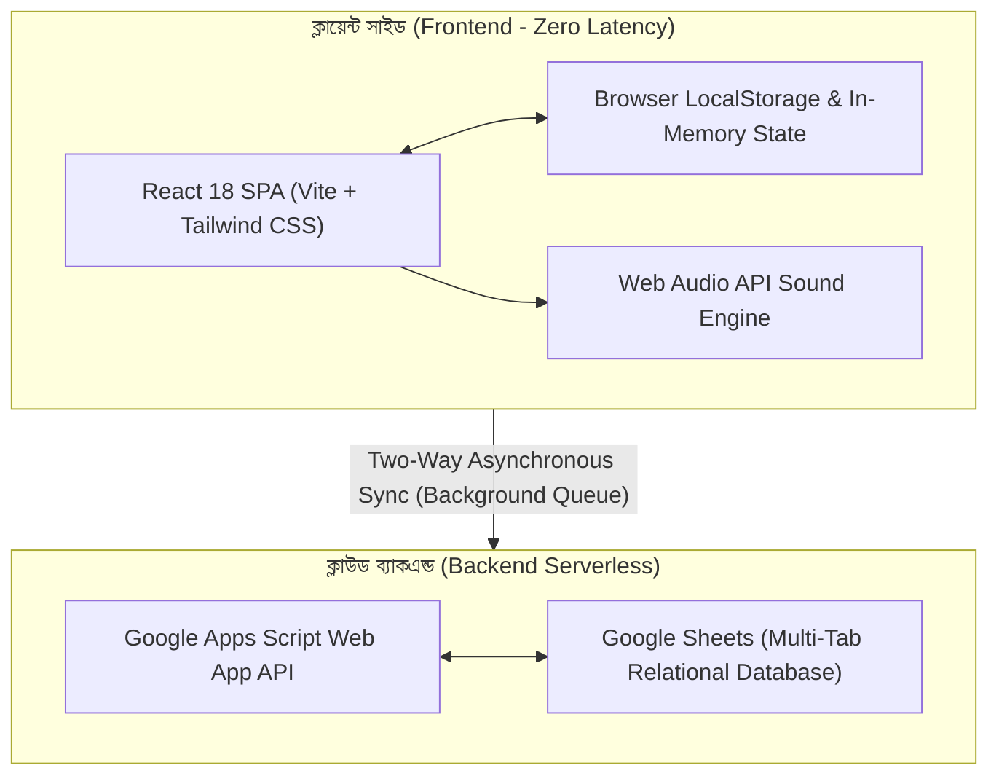
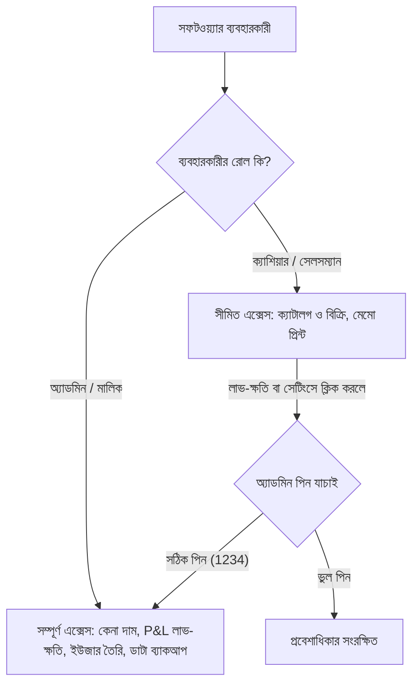

# পাবনা বস্ত্রালয় — সম্পূর্ণ সিস্টেম টেকনিক্যাল ও ফাংশনাল ডকুমেন্টেশন
**Pabna Bostraloy Enterprise POS & Inventory Ecosystem**  
*সংস্করণ: ৩.৫ প্রো (Enterprise Edition) | ভাষা: প্রমিত বাংলা | আর্কিটেকচার: অফলাইন-ফার্স্ট হাইব্রিড ক্লাউড*

---

## সূচিপত্র (Table of Contents)
1. [সিস্টেম পরিচিতি ও মূল উদ্দেশ্য](#১-সিস্টেম-পরিচিতি-ও-মূল-উদ্দেশ্য)
2. [সিস্টেম আর্কিটেকচার ও প্রযুক্তি স্ট্যাক](#২-সিস্টেম-আর্কিটেকচার-ও-প্রযুক্তি-স্ট্যাক)
3. [গুগল শিট ডাটাবেস স্কিমা ও টেবিলসমূহ](#৩-গুগল-শিট-ডাটাবেস-স্কিমা-ও-টেবিলসমূহ)
4. [সকল মডিউল ও অপশনের গভীর কার্যপ্রণালী](#৪-সকল-মডিউল-ও-অপশনের-গভীর-কার্যপ্রণালী)
   - [৪.১ বিক্রয় ও বিলিং মডিউল (Sales & POS)](#৪১-বিক্রয়-ও-বিলিং-মডিউল-sales--pos)
   - [৪.২ ইনভেন্টরি ও গোডাউন মডিউল (Inventory & Stock)](#৪২-ইনভেন্টরি-ও-গোডাউন-মডিউল-inventory--stock)
   - [৪.৩ সাপ্লায়ার ও প্রকিউরমেন্ট মডিউল (Procurement)](#৪৩-সাপ্লায়ার-ও-প্রকিউরমেন্ট-মডিউল-procurement)
   - [৪.৪ গ্রাহক ও সিআরএম মডিউল (CRM & Loyalty)](#৪৪-গ্রাহক-ও-সিআরএম-মডিউল-crm--loyalty)
   - [৪.৫ আর্থিক হিসাব ও ক্যাশ ড্রয়ার মডিউল (Finance & P&L)](#৪৫-আর্থিক-হিসাব-ও-ক্যাশ-ড্রয়ার-মডিউল-finance--pl)
   - [৪.৬ সিস্টেম, স্টাফ ও ডাটা ব্যাকআপ মডিউল (Security & Backup)](#৪৬-সিস্টেম-স্টাফ-ও-ডাটা-ব্যাকআপ-মডিউল-security--backup)
5. [ইনস্টলেশন, কনফিগারেশন ও ডেপ্লয়মেন্ট](#৫-ইনস্টলেশন-কনফিগারেশন-ও-ডেপ্লয়মেন্ট)
6. [নিরাপত্তা ও অ্যাক্সেস কন্ট্রোল (Security & Roles)](#৬-নিরাপত্তা-ও-অ্যাক্সেস-কন্ট্রোল-security--roles)
7. [ট্রাবলশুটিং ও সাধারণ প্রশ্নোত্তর (FAQ)](#৭-ট্রাবলশুটিং-ও-সাধারণ-প্রশ্নোত্তর-faq)

---

## ১. সিস্টেম পরিচিতি ও মূল উদ্দেশ্য
**পাবনা বস্ত্রালয় পিওএস ও ইনভেন্টরি ইকোসিস্টেম** হলো বাংলাদেশের রিটেইল পোশাক, শাড়ি, থ্রি-পিস ও থান কাপড়ের ব্যবসার জন্য বিশেষভাবে প্রস্তুতকৃত একটি আধুনিক ক্লাউড-ইন্টিগ্রেটেড অফলাইন-ফার্স্ট বিজনেস সফটওয়্যার।

### কেন এই সিস্টেমটি সাধারণ পিওএস সফটওয়্যার থেকে আলাদা?
1. **থান কাপড়ের ভগ্নাংশ গজ ও মিটার বিক্রি:** সাধারণ সুপারশপের সফটওয়্যারে কেবল পূর্ণ সংখ্যা (১টি, ২টি) বিক্রি করা যায়। কিন্তু বস্ত্রালয়ে থান থেকে ২.২৫ গজ, ৩.৫ গজ বা ১ পোয়া/১ গিরা কাপড় কাটার প্রয়োজন হয়। এই সিস্টেমে মিলি-সেকেন্ডে দশমিক গজ ও গিরার ভগ্নাংশ দাম স্বয়ংক্রিয়ভাবে হিসাব হয়।
2. **কাস্টম টেইলারিং ও সেলাই অর্ডার হাব:** কাপড় বিক্রির পাশাপাশি কাস্টমারের পাঞ্জাবি, শার্ট বা ব্লেজারের শরীরের মাপজোখ সংরক্ষণ, কারিগর বরাদ্দ, অগ্রিম জমা এবং ডেলিভারি ট্র্যাকিং সম্পূর্ণ একীভূত।
3. **থান কাপড়ের ছাঁট ও ড্যামেজ অপচয় ট্র্যাকার:** কাপড় কাটার পর যে ছোট টুকরা (কাটপিস) নষ্ট হয়, তার আর্থিক ক্ষতি হিসাব করা এবং তাকে এক ক্লিকে 'ছাঁট বান্ডিল প্যাক' হিসেবে ক্যাটালগে তুলে দেওয়ার আধুনিক সুবিধা।
4. **প্রকৃত নিট লাভ-ক্ষতি (True Net P&L):** বিক্রয় থেকে শুধু কেনা দাম নয়, বরং দোকানের পরিচালন খরচ (ভাড়া, বিদ্যুৎ, কর্মচারীদের নাস্তা) এবং কাপড়ের ছাঁট অপচয় স্বয়ংক্রিয়ভাবে বাদ দিয়ে মালিকের পকেটে আসা আসল নগদ লাভ বের করে।
5. **ক্যাশিয়ারের কাছ থেকে কেনা দাম সুরক্ষা (`🔒 সুরক্ষিত`):** কর্মচারীরা যাতে পণ্যের মূল ক্রয়মূল্য দেখতে না পারে, সেজন্য ক্যাশিয়ারের ভিউতে কেনা দাম সম্পূর্ণ হাইড রাখা হয়। মালিক প্রয়োজনবোধে ৪-সংখ্যার অ্যাডমিন পিন দিয়ে তাৎক্ষণিক তা দেখতে পারেন।
6. **১-ক্লিক ডাটা ব্যাকআপ ও এক্সেল হাব:** সম্পূর্ণ দোকানের ডাটা একটি ক্লিকে ব্যাকআপ ফাইল (.json) হিসেবে ডাউনলোড ও রিস্টোর করা যায় এবং এক্সেল শিটে সব তথ্য এক্সপোর্ট করা যায়।

---

## ২. সিস্টেম আর্কিটেকচার ও প্রযুক্তি স্ট্যাক



### প্রযুক্তি স্ট্যাকের বিবরণ:
- **ইউজার ইন্টারফেস:** React 18, Vite, Tailwind CSS (Responsive Desktop/Tablet/Mobile Layout)
- **আইকন ও ভিজ্যুয়াল:** Lucide React Icons
- **অডিও ইঞ্জিন:** Web Audio API (বারকোড বিফ, ক্যাশ মেমো ট্রানজ্যাকশন সাউন্ড ও সতর্কবার্তা)
- **লোকাল ডাটাবেস:** Browser LocalStorage (জিরো-লেটেন্সি ও অফলাইন সাপোর্ট)
- **ক্লাউড ডাটাবেস ও এপিআই:** Google Sheets API পরিচালিত Google Apps Script (Serverless, কোনো মাসিক সার্ভার ফি নেই)
- **রিপোর্টিং ও এক্সপোর্ট:** UTF-8 BOM যুক্ত CSV/Excel জেনারেটর এবং প্রিন্ট সিএসএস ইঞ্জিন (৮০মিমি থার্মাল ও এ৪)

---

## ৩. গুগল শিট ডাটাবেস স্কিমা ও টেবিলসমূহ

গুগল স্প্রেডশিটে প্রতিটি বিষয়ের জন্য একটি করে আলাদা শিট (ট্যাব) ব্যবহৃত হয়:

| শিটের নাম (Tab Name) | মূল ফিল্ডসমূহ | বিবরণ |
|---|---|---|
| **Products** | `ProductID, ProductName, Barcode, Category, SubCategory, CostPrice, SellingPrice, MinSellingPrice, StockQuantity, Unit, HasVariants, VariantsJSON, IsBundle, BundleItemsJSON, ExpDate, BatchNumber` | সকল রেডিমেড পোশাক, শাড়ি ও থান কাপড়ের পূর্ণ ক্যাটালগ ও লাইভ মজুত। |
| **SalesHistory** | `InvoiceNo, Timestamp, CustomerName, CustomerPhone, TotalItems, SubTotal, DiscountAmount, TaxAmount, GrandTotal, PaidAmount, DueAmount, PaymentMethod, CashierEmail` | সম্পন্ন হওয়া প্রতিটি বিক্রয় রসিদ ও ক্যাশ মেমোর বিস্তারিত ইতিহাস। |
| **Orders** | `OrderID, OrderDate, CustomerName, CustomerPhone, OrderSource, ItemsJSON, TotalAmount, AdvancePaid, DueAmount, Status, CourierName, PaymentStatus` | ওমনিচ্যানেল (কাউন্টার + অনলাইন + কুরিয়ার) সকল অর্ডারের কেন্দ্রীয় লাইফসাইকেল। |
| **Customers** | `CustomerID, CustomerName, Phone, Email, Address, CustomerType, TotalPurchases, TotalPaid, CurrentDue, LoyaltyPoints, CreditLimit` | ক্রেতাদের তথ্য, আজীবন কেনাকাটা, বর্তমান বাকি ও লয়ালটি পয়েন্ট। |
| **CustomerLedger** | `LedgerID, Timestamp, CustomerID, CustomerName, OrderID, EntryType, Debit, Credit, Balance, PaymentMethod, CollectedBy, Notes` | গ্রাহকদের বাকির খাতা; দেনা ও পরিশোধের প্রতিটি ট্রানজ্যাকশন অডিট ট্রেইল। |
| **Suppliers** | `SupplierID, CompanyName, ContactPerson, Phone, Address, TotalPurchases, TotalPaid, CurrentPayable` | কাপড় সরবরাহকারী মিল, ডিলার ও মহাজনদের তালিকা ও দেনা হিসাব। |
| **PurchaseOrders** | `PO_ID, SupplierID, SupplierName, OrderDate, ExpectedDate, ItemsJSON, TotalAmount, PaidAmount, DueAmount, Status, ReceivedBy` | মহাজনদের কাছে মাল ক্রয়ের অর্ডার ও চালান রিসিভ রেকর্ড। |
| **SupplierLedger** | `LedgerID, Timestamp, SupplierID, PO_ID, EntryType, Debit, Credit, Balance, PaymentMethod, Notes` | মহাজনদের বিল পরিশোধের ডেবিট-ক্রেডিট লেজার। |
| **Expenses** | `ExpenseID, Date, Category, Amount, PaymentMethod, Description, RecordedBy` | দোকান ভাড়া, বিদ্যুৎ, কর্মচারী ও দৈনন্দিন পরিচালন খরচের খাতা। |
| **CashRegisters** | `SessionID, OpeningDate, ClosingDate, OpeningBalance, ExpectedCash, ActualCash, Discrepancy, Status, OpenedBy, ClosedBy` | প্রতিদিনের কাউন্টার ক্যাশ ড্রয়ার ওপেনিং ও ইওডি (EOD) ক্লোজিং ব্যালেন্স। |
| **TailoringOrders** | `OrderID, TokenNo, CustomerName, CustomerPhone, GarmentType, MeasurementsJSON, FabricSource, FabricProductID, FabricYards, TailorMaster, StitchingCharge, AdvancePaid, DueAmount, Status, DeliveryDate` | দর্জি কারিগরের সেলাই অর্ডার, শরীরের মাপজোখ ও ডেলিভারি রিপোর্ট। |
| **FabricWastage** | `WastageID, Date, ProductID, ProductName, TotalYards, CostPricePerYard, LossAmount, Reason, RecordedBy` | থান কাপড়ের অপচয়, নষ্ট বা ছাঁট কাপড়ের ক্ষতি ট্র্যাকিং খাতা। |
| **SalesReturns** | `ReturnID, InvoiceNo, ReturnDate, CustomerID, ItemsJSON, TotalRefundAmount, RefundMethod, CreditNoteCode, CreditNoteStatus` | ফেরত আনা পণ্য, রিপ্লেসমেন্ট এবং স্টোর ক্রেডিট ভাউচার রেকর্ড। |
| **StockTransfers** | `TransferID, Date, FromLocation, ToLocation, ItemsJSON, Status, DispatchedBy, ReceivedBy` | মূল গোডাউন থেকে দোকানে অথবা শাখা টু শাখা কাপড় চালান রেকর্ড। |
| **Coupons** | `CouponCode, DiscountType, DiscountValue, MinSpend, ExpiryDate, UsageLimit, UsedCount, IsActive` | উৎসব ও বিশেষ ক্যাম্পেইনের প্রোমোশনাল ডিসকাউন্ট কোড। |
| **AuditLogs** | `LogID, Timestamp, UserID, UserName, ActionType, Module, Details` | স্পর্শকাতর কাজের অপরিবর্তনীয় সিকিউরিটি লগ। |
| **Settings** | `StoreName, Address, Phone, CurrencySymbol, TaxRatePercent, LoyaltyEnabled, AdminPIN, StorefrontBannerText` | দোকানের সাধারণ ও নিরাপত্তা কনফিগারেশন। |

---

## ৪. সকল মডিউল ও অপশনের গভীর কার্যপ্রণালী

### ৪.১ বিক্রয় ও বিলিং মডিউল (Sales & POS)

#### ১. পণ্য ক্যাটালগ ও পিওএস গ্রিড (Product Catalog)
- **বারকোড দিয়ে দ্রুত বিলিং:** বারকোড রিডার দিয়ে কাপড়ের ট্যাগ স্ক্যান করার সাথে সাথে কোনো ক্লিক ছাড়াই আইটেমটি স্বয়ংক্রিয়ভাবে কার্টে চলে যায়।
- **ক্যামেরা স্ক্যানার:** মোবাইল বা ট্যাবলেটের ক্যামেরা দিয়ে বারকোড স্ক্যান করার জন্য সার্চ বারে ক্যামেরা আইকন রয়েছে।
- **লাইভ ফিল্টারিং:** নাম, বারকোড বা ক্যাটাগরি (শাড়ি, থ্রি-পিস, থান কাপড়) দিয়ে মুহূর্তের মধ্যে পণ্য খুঁজে বের করা যায়।

#### ২. শপিং কার্ট ও দরদাম সুরক্ষা (Cart & Bargaining)
- **লাইভ দাম পরিবর্তন:** ক্রেতার সাথে দামাদামি করে নির্ধারিত মূল্যের চেয়ে কম বা বেশিতে বিক্রি করতে চাইলে কার্ট আইটেমের পেন্সিল আইকনে ক্লিক করে নতুন দাম বসানো যায়।
- **ফ্লোর প্রাইস সুরক্ষা (Floor Price Lock):** প্রতিটি পণ্যের একটি মিনিমাম বিক্রয়মূল্য (ফ্লোর প্রাইস) থাকে যা সাধারণত কেনা দামের সমান বা বেশি। ক্যাশিয়ার ভুলবশত বা ইচ্ছাকৃতভাবে কেনা দামের নিচে দাম কমাতে গেলে সিস্টেম সাথে সাথে লাল সতর্কবার্তা দিয়ে আটকে দেয়।

#### ৩. থান কাপড়ের বিশেষ কাটিং স্টুডিও (Fabric Cutting)
- থান কাপড় বিক্রির সময় 'কাটিং' বাটন চাপলে পপআপ খোলে।
- **দশমিক গজ ও গিরা:** সরাসরি ২.৫ গজ বা ২ গিরা (৪.৫ ইঞ্চি) বোতাম চেপে সঠিক ভগ্নাংশ নির্ধারণ করা যায়।
- সিস্টেম সাথে সাথে গজ ও মিটারের কনভার্সন এবং মূল্য হিসাব করে মেমোতে যুক্ত করে।

#### ৪. কাউন্টার অর্ডার হোল্ড (Held Orders / Queue Management)
- একজন কাস্টমার কাপড় বাছাই করে অন্য কাপড় দেখার জন্য সময় নিলে কার্ট পেজের নিচে 'অর্ডার হোল্ড করুন' বাটন চাপলে তার কার্টটি নিরাপদে হোল্ড হয়ে যায়।
- ক্যাশিয়ার পরের কাস্টমারের দ্রুত বিল করে বিদায় দিতে পারে।
- কাজ শেষে 'হোল্ডকৃত অর্ডার (Queue)' বাটনে ক্লিক করে এক ক্লিকে পূর্বের কাস্টমারের সব আইটেম কার্টে ফিরিয়ে আনা যায়।

#### ৫. চেকআউট পেজ ও পেমেন্ট নিষ্পত্তি (Checkout System)
- **কাস্টমার ডেটাবেস সিঙ্ক:** মোবাইল নম্বর লিখলে পুরনো কাস্টমারের নাম, পূর্বের বকেয়া ও লয়ালটি পয়েন্ট ভেসে ওঠে।
- **পেমেন্ট মেথড:** ক্যাশ, বিকাশ, নগদ, কার্ড, স্প্লিট পেমেন্ট (কিছু ক্যাশ + বাকি বিকাশ) এবং বাকিতে বিক্রি।
- **ভাউচার ও কুপন:** কুপন কোড এবং রিটার্ন পণ্যের 'স্টোর ক্রেডিট ভাউচার' দিয়ে বিল থেকে সরাসরি ছাড় নেওয়া যায়।

#### ৬. ইউনিফাইড অর্ডার ও ডেলিভারি (Omnichannel Orders)
- ইন-স্টোর পিওএস মেমো ছাড়াও অনলাইন ও ফেসবুক অর্ডারের পার্সেল ট্র্যাকিং (Pending ➔ Confirmed ➔ Shipped ➔ Delivered)।

#### ৭. টেইলারিং ও সেলাই অর্ডার স্টুডিও (Tailoring Studio)
- পাঞ্জাবি, শার্ট, প্যান্ট, বোরকা বা স্যুটের কাস্টম শরীরের মাপজোখ ইনপুট।
- দোকানের থান কাপড় নাকি কাস্টমারের কাপড় তা নির্বাচন (দোকানের কাপড় হলে স্বয়ংক্রিয়ভাবে ইনভেন্টরি থেকে গজ কাটা হবে)।
- কারিগর (টেইলার মাস্টার) বরাদ্দ, ডেলিভারি তারিখ, মজুরি ও অগ্রিম জমা নির্ধারণ এবং গ্রাহককে রসিদ প্রদান।

#### ৮. সেলস রিটার্ন ও এক্সচেঞ্জ (Sales Return & RMA)
- মেমো নম্বর দিয়ে ফেরত আনা কাপড় খোঁজা।
- কাপড় ভালো থাকলে 'পুনর্বিক্রয়যোগ্য (Resellable)' চিহ্নিত করা (তাৎক্ষণিক স্টকে ফিরে যাবে), নষ্ট থাকলে 'ড্যামেজ' চিহ্নিত করা।
- নগদ রিফান্ড, বকেয়া কর্তন অথবা ভবিষ্যতের কেনাকাটার জন্য 'স্টোর ক্রেডিট ভাউচার' প্রদান।

#### ৯. ইনভয়েস অনুসন্ধান ও প্রিন্ট (Multi-Format Printing)
- **৮০মিমি থার্মাল পিওএস রসিদ:** ছোট কাউন্টার প্রিন্টারে দ্রুত প্রিন্টের জন্য।
- **ক্লাসিক এ৪ সাইজ মেমো:** বড় অফিসিয়াল ইনভয়েস।
- **হোয়াটসঅ্যাপ ডিজিটাল মেমো:** এক ক্লিকে গ্রাহকের হোয়াটসঅ্যাপে পেপারলেস ডিজিটাল রসিদ পাঠানো।

---

### ৪.২ ইনভেন্টরি ও গোডাউন মডিউল (Inventory & Stock)

#### ১. নতুন পণ্য তৈরি (Add Product)
- সাধারণ পণ্য, সাইজ/কালার ভ্যারিয়েন্টযুক্ত পণ্য (যেমন: পাঞ্জাবি M/L/XL) অথবা কম্বো গিফট প্যাক তৈরি।
- স্বয়ংক্রিয় ইউনিক বারকোড তৈরি ও সেভ।

#### ২. স্টক ইনপুট ও রিস্টক (Quick Restock)
- নতুন কাপড় দোকানে আসলে স্টক যোগ করার সাথে সাথে পুরনো ও নতুন কেনা দামের সমন্বয়ে **ওয়েটেড এভারেজ কস্ট (Weighted Average Cost)** স্বয়ংক্রিয়ভাবে হিসাব করা।

#### ৩. কম স্টক ও মেয়াদ সতর্কতা (Low Stock & Expiry Alerts)
- কাপড় বা প্রসাধনীর মজুত রি-অর্ডার লেভেলের নিচে নামলে বা মেয়াদোত্তীর্ণ হওয়ার ৩০ দিন পূর্বে সাইডবারে অ্যালার্ট ব্যাজ প্রদর্শন।

#### ৪. গোডাউন টু দোকান চালান ট্রান্সফার (Stock Transfers)
- মূল গোডাউন থেকে দোকানে কাপড় স্থানান্তরের চালান তৈরি (In Transit) এবং দোকান রিসিভ করার পর স্টকে স্বয়ংক্রিয় অন্তর্ভুক্তি।

#### ৫. বারকোড ও প্রাইস ট্যাগ প্রিন্টার (Barcode Printing)
- থার্মাল স্টিকারে দোকানের নাম, কাপড়ের নাম, সাইজ, বিক্রয়মূল্য ও স্ক্যানযোগ্য বারকোড প্রিন্ট।

#### ৬. কাপড়ের ছাঁট ও অপচয় ট্র্যাকার (Fabric Scrap & Wastage)
- থান কাটার পর অবশিষ্ট নষ্ট/ছাঁট কাপড় লিখে এন্ট্রি দিলে মূল থানের স্টক থেকে বাদ যায়।
- ছাঁটের ক্রয়মূল্য আর্থিক P&L বিবরণীতে লোকসান (Loss) হিসেবে যুক্ত হয়।
- ছাঁট কাপড়কে এক ক্লিকে 'ছাঁট বান্ডিল প্যাক' হিসেবে ক্যাটালগে যুক্ত করে কম দামে বিক্রি করার সুবিধা।

---

### ৪.৩ সাপ্লায়ার ও প্রকিউরমেন্ট মডিউল (Procurement)

#### ১. পারচেজ অর্ডার (Purchase Orders - PO)
- মহাজন ও মিল থেকে পাইকারি কাপড় ক্রয়ের অফিসিয়াল অর্ডার তৈরি।
- মাল দোকানে এসে পৌঁছানোর পর চালানের 'Received' বাটন চাপলে ইনভেন্টরি স্টকে মাল ঢুকে যায় এবং মহাজনের নামে দেনা রেকর্ড হয়।

#### ২. মহাজন দেনা পরিশোধ লেজার (Supplier Ledger)
- মহাজনদের নাম, ঠিকানা ও বকেয়া তালিকা।
- নগদ বা ব্যাংকে টাকা দিলে পরিশোধের ভাউচার তৈরি ও দেনা সমন্বয়।

---

### ৪.৪ গ্রাহক ও সিআরএম মডিউল (CRM & Loyalty)

#### ১. কাস্টমার বাকির খাতা ও লেজার (Customer Due Ledger)
- বাকিতে বিক্রির প্রতিটি রেকর্ড এবং গ্রাহকের মোট বকেয়া প্রদর্শন।
- কাস্টমার টাকা পরিশোধ করলে 'বকেয়া আদায়' করে প্রিন্টযোগ্য কালেকশন রিসিট প্রদান।

#### ২. আরএফএম (RFM) সেগমেন্টেশন ও স্মার্ট SMS মার্কেটিং
- এআই অ্যালগরিদম দ্বারা গ্রাহকদের ৪টি ভাগে ভাগ করা (চ্যাম্পিয়ন, নিয়মিত, ঝুঁকিপূর্ণ এবং হারিয়ে যাওয়া ক্রেতা)।
- ঈদ বা পূজার ছাড়ে এক ক্লিকে সকল গ্রাহকের মোবাইলে বাংলায় শুভেচ্ছা ও অফার মেসেজ পাঠানোর ব্যবস্থা।

---

### ৪.৫ আর্থিক হিসাব ও ক্যাশ ড্রয়ার মডিউল (Finance & P&L)

#### ১. প্রকৃত নিট লাভ-ক্ষতি ও P&L বিবরণী (Multi-Step Net P&L)
```
মোট বিক্রয় (Gross Sales)
  - মোট ছাড় (Discounts)
= নিট বিক্রয় রাজস্ব (Net Sales)
  - বিক্রিত পণ্যের মূল খরচ (COGS)
= মোট বিক্রয় মুনাফা (Gross Profit)
  - দোকানের পরিচালন খরচ (Store Expenses: ভাড়া, বিদ্যুৎ, স্টাফ)
  - থান কাপড়ের ছাঁট অপচয় ক্ষতি (Fabric Scrap Loss)
= চূড়ান্ত প্রকৃত নিট পরিচালন লাভ (True Net Operating Profit)
```

#### ২. ক্যাশ রিয়ালাইজেশন ও বাকির খাতার সমন্বয় (Realized Cash Profit)
- কাগজে-কলমে লাভের পাশাপাশি ক্যাশ ড্রয়ারে আসলে কত টাকা নগদ লাভ আসলো তা হিসাব করা:
  `আসল নগদ লাভ = (নগদ বিক্রয় + বাকির আদায়) - পণ্যের মূল খরচ`

#### ৩. দৈনিক ক্যাশ ড্রয়ার ক্লোজিং (Daily Cash Register / EOD)
- সকালে ক্যাশ ড্রয়ারে খুচরা টাকা দিয়ে সেশন ওপেন।
- সারাদিনের ক্যাশ বিক্রি, বাকির আদায়, টেইলারিং অগ্রিম ক্যাশ এবং ক্যাশ খরচ বাদ দিয়ে দিন শেষে ক্যাশ বাক্সে কত টাকা থাকার কথা (Expected Cash) তা নির্ধারণ।
- ক্যাশিয়ার ড্রয়ার গুনে টাকা বসালে কোনো গরমিল (Short / Over) থাকলে তা রিপোর্টে চিহ্নিত করা।

#### ৪. সিকিউরিটি অডিট ট্রেইল (Audit Trail)
- সিস্টেমে কে কখন লগইন করেছে, কোন পণ্য এডিট করেছে বা কোন মেমো রিফান্ড করেছে তার অপরিবর্তনীয় লগ।

---

### ৪.৬ সিস্টেম, স্টাফ ও ডাটা ব্যাকআপ মডিউল (Security & Backup)

#### ১. কেনা দাম সুরক্ষা (`🔒 সুরক্ষিত`) ও অ্যাডমিন পিন শিল্ড
- ক্যাশিয়ার অ্যাকাউন্টে কেনা দাম এবং লাভ-ক্ষতির রিপোর্ট লুকানো থাকে।
- দোকান মালিক ক্যাশিয়ার কম্পিউটারে বসেই ৪-সংখ্যার গোপন অ্যাডমিন পিন (ডিফল্ট: ১২৩৪) দিয়ে তাৎক্ষণিক সাময়িক আনলক করতে পারেন।

#### ২. ১-ক্লিক সম্পূর্ণ ডাটাবেস ব্যাকআপ ও রিস্টোর
- **ব্যাকআপ ডাউনলোড:** একক ক্লিকে সম্পূর্ণ দোকানের ডাটাবেস (পণ্য, কেনা দাম, বিক্রয় ইতিহাস, কাস্টমার, বাকির খাতা, খরচ, টেইলারিং ও অপচয়) একটি নিরাপদ `.json` ফাইলে ডাউনলোড।
- **নিরাপদ রিস্টোর:** ব্যাকআপ ফাইলের ভেতরের তথ্য প্রিভিউ দেখে এক ক্লিকে সম্পূর্ণ ডাটাবেস রিস্টোর।

#### ৩. এক্সেল স্প্রেডশীট হাব (UTF-8 BOM CSV)
- পণ্য ক্যাটালগ এক্সেল
- বিক্রয় ও মেমো হিস্ট্রি এক্সেল
- টেইলারিং অর্ডার রেজিস্টার এক্সেল
- গ্রাহক ও বাকির খাতা এক্সেল

---

## ৫. ইনস্টলেশন, কনফিগারেশন ও ডেপ্লয়মেন্ট

### ৫.১ পূর্বশর্ত (Prerequisites)
- [Node.js](https://nodejs.org/) (সংস্করণ ১৮ বা তার পরবর্তী)
- গুগল ক্রোম বা মাইক্রোসফট এজ ব্রাউজার

### ৫.২ লোকাল ডেভেলপমেন্টে রান করা
```bash
# ১. রিপোজিটরি ক্লোন বা ফোল্ডারে প্রবেশ
cd "d:\VS_test program\google sheet inventory"

# ২. ফ্রন্টএন্ড প্যাকেজ ইনস্টল
npm --prefix frontend install

# ৩. লোকাল ডেভ সার্ভার চালু
npm --prefix frontend run dev
```
ব্রাউজারে `http://localhost:5173` খুললে সিস্টেম চালু হবে।

### ৫.৩ প্রোডাকশন বিল্ড তৈরি
```bash
npm --prefix frontend run build
```
এটি `frontend/dist/` ফোল্ডারে অপ্টিমাইজড প্রোডাকশন বিল্ড তৈরি করবে।

### ৫.৪ গুগল অ্যাপস স্ক্রিপ্ট ব্যাকএন্ড স্থাপন
1. একটি নতুন গুগল স্প্রেডশিট তৈরি করুন।
2. `Extensions` ➔ `Apps Script` এ যান।
3. প্রজেক্টের `Code.gs` কোড সেখানে পেস্ট করে সেভ করুন।
4. `Deploy` ➔ `New Deployment` ➔ `Web App` নির্বাচন করুন:
   - **Execute as:** Me (আপনার গুগল একাউন্ট)
   - **Who has access:** Anyone
5. প্রাপ্ত Web App URL-টি কপি করে সফটওয়্যারের টপবার সেটিংস অপশনের `API URL` ঘরে বসিয়ে সেভ করুন।

---

## ৬. নিরাপত্তা ও অ্যাক্সেস কন্ট্রোল (Security & Roles)



---

## ৭. ট্রাবলশুটিং ও সাধারণ প্রশ্নোত্তর (FAQ)

**প্রশ্ন ১: ইন্টারনেট সংযোগ বিচ্ছিন্ন হয়ে গেলে সফটওয়্যার কি বন্ধ হয়ে যাবে?**  
*উত্তর:* একদমই না। সিস্টেমটি সম্পূর্ণ 'অফলাইন-ফার্স্ট'। ইন্টারনেট না থাকলেও বিক্রয়, মেমো প্রিন্ট, বারকোড স্ক্যান এবং টেইলারিং অর্ডার স্বাভাবিক গতিতে চলবে। ইন্টারনেট সংযোগ ফিরে আসলে তা স্বয়ংক্রিয়ভাবে ক্লাউডে সিঙ্ক হয়ে যাবে।

**প্রশ্ন ২: ক্যাশিয়ার কি কোনোভাবে কাপড়ের কেনা দাম জানতে পারবে?**  
*উত্তর:* না। ক্যাশিয়ারের প্রোফাইলে কেনা দামের স্থানে `🔒 সুরক্ষিত` ব্যাজ প্রদর্শিত থাকে এবং লাভের রিপোর্ট তার জন্য লক করা থাকে।

**প্রশ্ন ৩: কম্পিউটার নষ্ট বা চুরি হয়ে গেলে দোকানের ডাটা কি ফিরে পাওয়া সম্ভব?**  
*উত্তর:* হ্যাঁ, শতভাগ সম্ভব। গুগল স্প্রেডশিটে প্রতিটি মেমো ক্লাউডে ব্যাকআপ থাকে। এছাড়াও ১-ক্লিক ব্যাকআপের মাধ্যমে নেওয়া `.json` ফাইল দিয়ে নতুন যেকোনো কম্পিউটারে ১ সেকেন্ডে সম্পূর্ণ ডাটাবেস ফিরিয়ে আনা যায়।

**প্রশ্ন ৪: বারকোড স্ক্যানার দিয়ে স্ক্যান করলে কার্টে যোগ হচ্ছে না কেন?**  
*উত্তর:* বারকোড স্ক্যানারের ইউএসবি কেবল সঠিকভাবে লাগানো আছে কিনা এবং ইনপুট ফিল্ডে কার্সার আছে কিনা নিশ্চিত করুন। প্রয়োজনে সার্চ বারের ক্যামেরা বাটন চেপে মোবাইল ক্যামেরা দিয়ে স্ক্যান করুন।

---

*পাবনা বস্ত্রালয় — আপনার বিশ্বস্ত স্মার্ট ফ্যাশন ও ইনভেন্টরি পার্টনার*  
*ডকুমেন্টেশন প্রস্তুতকরণ: Google Deepmind Antigravity Pair-Programming Team*

