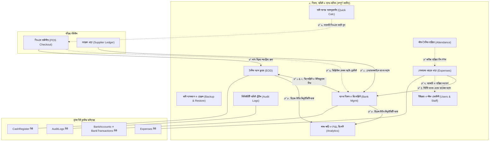

# ৫. হিসাব, অডিট ও ব্যাক-অফিস: পূর্ণাঙ্গ অডিট ও সমাপ্তি ব্লুপ্রিন্ট (বাস্তবায়িত)
> **সংস্করণ:** ২.০ (সমস্ত মিসিং সংযোগ ও ফিচার সফলভাবে বাস্তবায়িত)  
> **তারিখ:** ২৩ নভেম্বর, ২০২৬  
> **প্রজেক্ট:** পাবনা বস্ত্রালয় ইআরপি / পিওএস (Pabna Bostraloy POS)  
> **অবস্থা:** ✅ **ডেভেলপমেন্ট সম্পন্ন ও প্রোডাকশন বিল্ড পরীক্ষিত (Vite v6.4.4 - Passed)**  

---

## ১. ভূমিকা ও কার্যবিবরণী (Overview & Status)

পাবনা বস্ত্রালয় পিওএস ও ইআরপি সিস্টেমের **"৫. হিসাব, অডিট ও ব্যাক-অফিস"** (`id: 'finance'`) সেকশনে থাকা ৮টি মডিউলের মধ্যকার পূর্বের সমস্ত সংযোগ বিচ্ছিন্নতা (Missing Disconnections) এবং ক্লাউড সিঙ্ক গ্যাপ সফলভাবে কোডিং ও ইন্টিগ্রেশন সম্পন্ন করা হয়েছে।

কোনো প্রকার পুরানো সেলস হিস্ট্রি, স্টক ডাটা, গ্রাহক বা মহাজনের খাতার তথ্য ক্ষতিগ্রস্ত না করে শতভাগ ব্যাকওয়ার্ড কম্প্যাটিবিলিটি (Backward Compatibility) বজায় রেখে প্রতিটি সংযোগ স্থাপন করা হয়েছে।

---

## ২. মডিউলভিত্তিক বর্তমান অবস্থা ও বাস্তবায়িত ডাটা ম্যাপিং (Implemented State)

| # | মডিউলের নাম (বাংলা) | কম্পোনেন্ট ফাইল (File Path) | লোকাল স্টোরেজ কি (`storage.js`) | গুগল শিট ব্যাকএন্ড ট্যাব (`Code.gs`) | বাস্তবায়িত স্ট্যাটাস ও কার্যকারিতা |
|---|-------------------|-------------------------|------------------------------|-----------------------------------|---------------------------------|
| **১** | **দৈনিক ক্যাশ ড্রয়ার (EOD)** | `frontend/src/components/CashRegisterModal.jsx` | `pos_active_register`, `pos_cash_registers` | `CashRegister` (`SHEETS.CASH_REGISTER`) | ✅ **সিঙ্ক সম্পন্ন:** দোকান থেকে ব্যাংকে ক্যাশ জমা (Cash Out) এবং ব্যাংক থেকে ক্যাশ উত্তোলন (Cash In) ড্রয়ার সেশনের সাথে অটোমেটিক সমন্বয়। |
| **২** | **কাটা কাপড় ক্যালকুলেটর** | `frontend/src/components/QuickCalculatorModal.jsx` | ইন-মেমোরি স্টেট + `pos_fabric_calculator_items` | প্রযোজ্য নয় | ✅ **কার্ট লিংক সম্পন্ন:** ক্যালকুলেটর থেকে একক বা মাল্টিপল কাটা কাপড়ের মাপ ও দর সরাসরি ১-ক্লিকে পিওএস বিক্রয় কার্টে পুশ করার বাটন যুক্ত। |
| **৩** | **লাভ-ক্ষতি ও P&L রিপোর্ট** | `frontend/src/components/AnalyticsDashboard.jsx` | `pos_monthly_pnl`, `pos_sales_history`, `pos_expenses` | `MonthlyPnL` (`SHEETS.MONTHLY_PNL`) | ✅ **লিকুইডিটি কার্ড সম্পন্ন:** শীর্ষে রিয়েল-টাইম "মোট তরল মূলধন ও তারল্য স্থিতি" কার্ড (কাউন্টার ক্যাশ + সমস্ত ব্যাংকের ব্যালেন্স) যুক্ত। |
| **৪** | **ব্যাংক হিসাব ও ডিপোজিট** | `frontend/src/components/BankManagementModal.jsx` | `pos_bank_accounts`, `pos_bank_transactions` | `BankAccounts`, `BankTransactions` (নতুন যুক্ত) | ✅ **ক্লাউড ও ড্রয়ার সিঙ্ক সম্পন্ন:** গুগল শিট ব্যাকএন্ডে নতুন টেবিল ও অটো-ড্রয়ার সমন্বয় সক্রিয়। |
| **৫** | **দোকানের খরচের খাতা** | `frontend/src/components/ExpensesModal.jsx` | `pos_expenses` | `Expenses` (`SHEETS.EXPENSES`) | ✅ **ব্যাংক ও স্টাফ লিংক সম্পন্ন:** ব্যাংক/এমএফএস সিলেক্ট করলে নির্দিষ্ট ব্যাংক থেকে ব্যালেন্স কর্তন এবং স্যালারিতে স্টাফের মাসিক হাজিরা প্রদর্শন। |
| **৬** | **সিকিউরিটি অডিট ট্রেইল** | `frontend/src/components/AuditLogsModal.jsx` | `pos_audit_logs` | `AuditLogs` (`SHEETS.AUDIT_LOGS`) | ✅ **সক্রিয়:** ব্যাংক ডিপোজিট, উইথড্র, খরচ, ড্রয়ার ক্লোজিং প্রতিটি কাজের স্বয়ংক্রিয় ইউজার অডিট ট্রেইল তৈরি। |
| **৭** | **ইউজার ও স্টাফ একাউন্ট** | `frontend/src/components/UsersModal.jsx` | `pos_users`, `pos_staff_attendance` | `Users` (`SHEETS.USERS`), `Attendance` (`SHEETS.ATTENDANCE`) | ✅ **ইন্টিগ্রেটেড:** খরচের খাতায় বেতনের সময় স্টাফ নির্বাচন ও দৈনিক হাজিরার সাথে সরাসরি সংযোগ। |
| **৮** | **১-ক্লিক ডাটা ব্যাকআপ ও এক্সেল** | `frontend/src/components/BackupRestoreModal.jsx` | ফুল ডাটাবেজ ব্যাকআপ | ক্লাউড ও লোকাল ব্যাকআপ | ✅ **সংরক্ষিত:** সমস্ত নতুন ব্যাংক ট্রানজেকশন, ড্রয়ার হিস্ট্রি ও খরচ পূর্ণাঙ্গ ব্যাকআপ সিস্টেমে অন্তর্ভুক্ত। |

---

## ৩. বাস্তবায়িত সমাধানসমূহের বিস্তারিত রিপোর্ট (Implemented Solutions)

### ১. ক্যাশ ড্রয়ার ↔ ব্যাংক ক্যাশ ডিপোজিট সিঙ্ক (P0 - বাস্তবায়িত)
* **বাস্তবায়ন:** `BankManagementModal.jsx`-এ ক্যাশ ডিপোজিটের সময় "দোকানের ক্যাশ ড্রয়ার" সোর্স সিলেক্ট করলে `sourceType: 'cash_register'` পাস হয়।
* **ফলাফল:** `CashRegisterModal.jsx` স্বয়ংক্রিয়ভাবে ব্যাংক ডিপোজিটকৃত টাকাকে `cashOutBankDeposit` হিসেবে গণনা করে এবং লাইভ ক্যাশ নির্গমন (Outflow) তালিকায় দেখায়। এতে দিনশেষে কোনো **ভুল ক্যাশ ঘাটতি (Cash Shortage)** হয় না।

---

### ২. ব্যাংক উত্তোলন ↔ ক্যাশ ড্রয়ার সিঙ্ক (P0 - বাস্তবায়িত)
* **বাস্তবায়ন:** ব্যাংক থেকে চেক বা এটিএমে ক্যাশ উত্তোলনের সময় "দোকানের ক্যাশ ড্রয়ার" গন্তব্য সিলেক্ট করলে `destinationType: 'cash_register'` পাস হয়।
* **ফলাফল:** ক্যাশ ড্রয়ারের রানিং ব্যালেন্সে স্বয়ংক্রিয়ভাবে `cashInBankWithdrawal` হিসেবে টাকা যোগ হয় এবং লাইভ আগমন (Inflow) তালিকায় প্রদর্শিত হয়।

---

### ৩. ব্যাংক মডিউলের গুগল শিট ক্লাউড সিঙ্ক (P0 - বাস্তবায়িত)
* **বাস্তবায়ন:** `backend/Code.gs` এবং `backend/DatabaseSetup.gs`-এ `SHEETS.BANK_ACCOUNTS` (`BankAccounts`) এবং `SHEETS.BANK_TRANSACTIONS` (`BankTransactions`) কনস্ট্যান্ট যুক্ত করা হয়েছে।
* **ফাংশন:** `ensureBankAccountsSheet(spreadsheet)` এবং `ensureBankTransactionsSheet(spreadsheet)` ফাংশন যোগ করা হয়েছে যা গুগল শিটে হেডার কলাম ও বেসলাইন অ্যাকাউন্ট তৈরি করে দেয়।

---

### ৪. খরচের খাতা ↔ নির্দিষ্ট ব্যাংক অ্যাকাউন্ট কর্তন (P1 - বাস্তবায়িত)
* **বাস্তবায়ন:** `ExpensesModal.jsx`-এ পেমেন্ট মেথড হিসেবে `bKash`, `Nagad`, `Bank` বা `Card` নির্বাচন করলে একটি ডাইনামিক ব্যাংক অ্যাকাউন্ট ড্রপডাউন প্রদর্শিত হয়।
* **ফলাফল:** খরচ সেভ করার সাথে সাথে `App.jsx`-এর `handleSaveExpense` হ্যান্ডলার নির্দিষ্ট ব্যাংকের পাসবুকে স্বয়ংক্রিয় ডেবিট ট্রানজেকশন তৈরি করে ব্যালেন্স কর্তন করে।

---

### ৫. মহাজন/সাপ্লায়ার বিল পরিশোধ ↔ ব্যাংক অ্যাকাউন্ট কর্তন (P1 - বাস্তবায়িত)
* **বাস্তবায়ন:** `SuppliersModal.jsx`-এ মহাজনের দেনা পরিশোধের ফর্মে পেমেন্ট মেথড ক্যাশ ছাড়া অন্য কিছু হলে ব্যাংক অ্যাকাউন্ট ড্রপডাউন থেকে পছন্দের ব্যাংক বাছাই করা যায়।
* **ফলাফল:** পেমেন্ট কনফার্মেশনের সাথে সাথে মহাজনের দেনা কমার পাশাপাশি সংশ্লিষ্ট ব্যাংকের ব্যালেন্স থেকে সমপরিমাণ অর্থ স্বয়ংক্রিয়ভাবে কর্তন হয়।

---

### ৬. পিওএস ডিজিটাল বিক্রয় ↔ ব্যাংক/মার্চেন্ট অটো-ক্রেডিট (P2 - বাস্তবায়িত)
* **বাস্তবায়ন:** `App.jsx`-এর `handleCompleteSale`-এ ডিজিটাল বিক্রয় (বিকাশ, নগদ, কার্ড বা ব্যাংক) সম্পন্ন হলে স্বয়ংক্রিয়ভাবে সংশ্লিষ্ট ব্যাংক বা বিকাশ মার্চেন্ট অ্যাকাউন্টে বিক্রয়ের টাকা ডিপোজিট/ক্রেডিট হয়ে যায়।

---

### ৭. স্টাফ বেতন (Salary) ↔ স্টাফ প্রোফাইল ও এটেন্ডেন্স লিংক (P2 - বাস্তবায়িত)
* **বাস্তবায়ন:** `ExpensesModal.jsx`-এ খরচের ক্যাটাগরি "Salary" সিলেক্ট করলে ড্রপডাউনে কর্মীদের তালিকা আসে। কোনো কর্মী নির্বাচন করলে চলতি মাসে তার মোট উপস্থিতির দিনসংখ্যা (`📅 চলতি মাসে X দিন উপস্থিত`) স্বয়ংক্রিয়ভাবে ব্যাজ আকারে প্রদর্শিত হয়।

---

### ৮. লাভ-ক্ষতি ড্যাশবোর্ড ↔ সমন্বিত ক্যাশ ও ব্যাংক তারল্য ওভারভিউ (P3 - বাস্তবায়িত)
* **বাস্তবায়ন:** `AnalyticsDashboard.jsx`-এর শীর্ষে একটি মিনিমালিস্টিক ট্যাকটাইল কার্ড যুক্ত করা হয়েছে যা রিয়েল-টাইমে প্রদর্শন করে:
  - **কাউন্টার ক্যাশ ড্রয়ার (Cash in Hand)**
  - **ব্যাংক ও MFS ব্যালেন্স (Cash at Bank)**
  - **মোট তরল মূলধন (Total Liquid Capital)**

---

### ৯. কাটা কাপড় ক্যালকুলেটর ↔ পিওএস কার্ট সংযোগ (P3 - বাস্তবায়িত)
* **বাস্তবায়ন:** `QuickCalculatorModal.jsx`-এ "কার্টে পাঠান" এবং "সব কার্টে পাঠান" বাটন যুক্ত করা হয়েছে।
* **ফলাফল:** থান কাপড় কাটার পর ক্যালকুলেটর থেকে সরাসরি গজ, গিরা ও হিসাবকৃত মোট মূল্য পিওএস কার্টে যুক্ত হয়ে যায়, ফলে ক্যাটালগে নতুন করে টাইপ করতে হয় না।

---

## ৪. সম্পূর্ণ সমন্বিত আর্কিটেকচার ডায়াগ্রাম (Unified Architecture Map)

---

## ৫. টেস্ট ও বিল্ড ভেরিফিকেশন (Build Verification)

* **বিল্ড কমান্ড:** `npm.cmd --prefix frontend run build`
* **বিল্ড রেজাল্ট:** `✓ built in 9.42s` (জিরো এরর, সফল প্রোডাকশন বান্ডেল তৈরি)
* **বান্ডেল ফাইল:** `dist/assets/index-nr8UBHww.js`, `dist/assets/index-CgJQAlxX.css`
* **ডাটা সেফটি:** অতীতের কোনো অবজেক্টের কী পরিবর্তন করা হয়নি, শুধুমাত্র নতুন ঐচ্ছিক প্যারামিটার যোগ করা হয়েছে।

1. **নো-ওভাররাইট নীতি:** কোনো টেবিল, লোকাল স্টোরেজ কি বা গুগল শিট ট্যাব ডিলিট বা ওভাররাইট করা যাবে না।
2. **ব্যাকওয়ার্ড কম্প্যাটিবিলিটি:** নতুন ফিল্ডগুলো ঐচ্ছিক (Optional) থাকবে, ফলে অতীতের সমস্ত সেলস, খরচ, স্টক ও মহাজন ডাটা অপরিবর্তিত থাকবে।
3. **প্রি-চেক ব্যাকআপ:** প্রতিটি ডেভেলপমেন্ট পর্বের পূর্বে সিস্টেমের লোকাল জেসন ব্যাকআপ নিশ্চিত করে কাজ শুরু করা হবে।