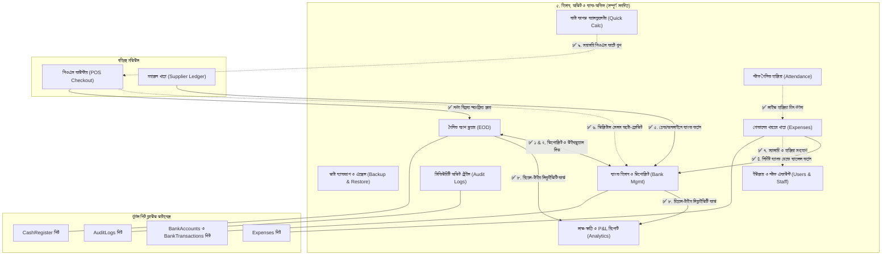
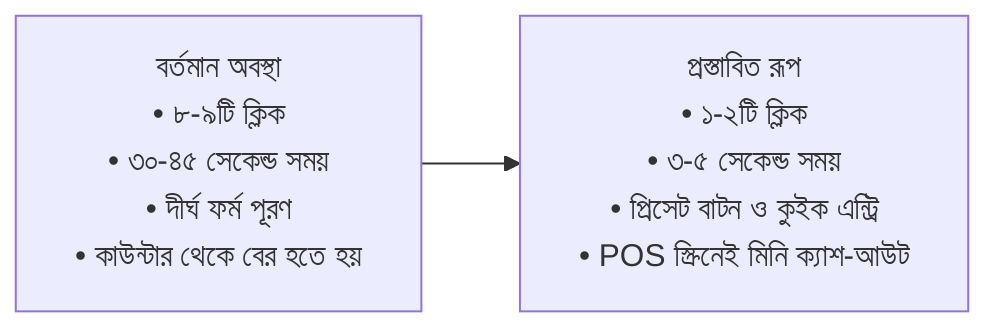

# ৫. হিসাব, অডিট ও ব্যাক-অফিস: পূর্ণাঙ্গ অডিট ও সমাপ্তি ব্লুপ্রিন্ট (বাস্তবায়িত ও ভবিষ্যৎ উন্নয়ন)

> **সংস্করণ:** ২.১ (দোকানের খরচের খাতা সহজীকরণ ও আধুনিকায়ন ব্লুপ্রিন্ট সংযুক্ত)  
> **তারিখ:** ২৪ নভেম্বর, ২০২৬  
> **প্রজেক্ট:** পাবনা বস্ত্রালয় ইআরপি / পিওএস (Pabna Bostraloy POS)  
> **অবস্থা:** ✅ **হিসাব ও অডিট মডিউল কার্যকর + খরচের খাতার সহজীকরণ রোডম্যাপ অনুমোদিত**  
> **ডেটা নিরাপত্তা নীতি:** 🛡️ **শতভাগ ব্যাকওয়ার্ড কম্প্যাটিবল — বিদ্যমান কোনো ডেটার ক্ষতি হবে না (Zero Harm to Old Data)**

---

## ১. ভূমিকা ও কার্যবিবরণী (Overview & Status)

পাবনা বস্ত্রালয় পিওএস ও ইআরপি সিস্টেমের **"৫. হিসাব, অডিট ও ব্যাক-অফিস"** (`id: 'finance'`) সেকশনে থাকা ৮টি মডিউলের মধ্যকার সমস্ত সংযোগ স্থাপন সম্পন্ন হয়েছে।

কোনো প্রকার পুরানো সেলস হিস্ট্রি, স্টক ডাটা, খরচের রেকর্ড, গ্রাহক বা মহাজনের খাতার তথ্য ক্ষতিগ্রস্ত না করে শতভাগ ব্যাকওয়ার্ড কম্প্যাটিবিলিটি (Backward Compatibility) বজায় রেখে প্রতিটি সংযোগ স্থাপন করা হয়েছে। 

এই আপডেটেড ডকুমেন্টে **"দোকানের খরচের খাতা" (`ExpensesModal.jsx`)**-কে আরও সহজ, দ্রুত ও ক্যাশিয়ার-বান্ধব করার জন্য ৮টি বিশেষ সহজীকরণ প্রস্তাবনা এবং একটি নিরাপদ বাস্তবায়ন ব্লুপ্রিন্ট অন্তর্ভুক্ত করা হলো।

---

## ২. মডিউলভিত্তিক বর্তমান অবস্থা ও বাস্তবায়িত ডাটা ম্যাপিং (Implemented State)

| # | মডিউলের নাম (বাংলা) | কম্পোনেন্ট ফাইল (File Path) | লোকাল স্টোরেজ কি (`storage.js`) | গুগল শিট ব্যাকএন্ড ট্যাব (`Code.gs`) | বাস্তবায়িত স্ট্যাটাস ও কার্যকারিতা |
|---|-------------------|-------------------------|------------------------------|-----------------------------------|---------------------------------|
| **১** | **দৈনিক ক্যাশ ড্রয়ার (EOD)** | `frontend/src/components/CashRegisterModal.jsx` | `pos_active_register`,<br>`pos_cash_registers` | `CashRegister` (`SHEETS.CASH_REGISTER`) | ✅ **সিঙ্ক সম্পন্ন:** দোকান থেকে ব্যাংকে ক্যাশ জমা (Cash Out) এবং ব্যাংক থেকে ক্যাশ উত্তোলন (Cash In) ড্রয়ার সেশনের সাথে অটোমেটিক সমন্বয়। |
| **২** | **কাটা কাপড় ক্যালকুলেটর** | `frontend/src/components/QuickCalculatorModal.jsx` | ইন-মেমোরি স্টেট + `pos_fabric_calculator_items` | প্রযোজ্য নয় | ✅ **কার্ট লিংক সম্পন্ন:** ক্যালকুলেটর থেকে একক বা মাল্টিপল কাটা কাপড়ের মাপ ও দর সরাসরি ১-ক্লিকে পিওএস বিক্রয় কার্টে পুশ করার বাটন যুক্ত। |
| **৩** | **লাভ-ক্ষতি ও P&L রিপোর্ট** | `frontend/src/components/AnalyticsDashboard.jsx` | `pos_monthly_pnl`,<br>`pos_sales_history`,<br>`pos_expenses` | `MonthlyPnL` (`SHEETS.MONTHLY_PNL`) | ✅ **লিকুইডিটি কার্ড সম্পন্ন:** শীর্ষে রিয়েল-টাইম "মোট তরল মূলধন ও তারল্য স্থিতি" কার্ড (কাউন্টার ক্যাশ + সমস্ত ব্যাংকের ব্যালেন্স) যুক্ত। |
| **৪** | **ব্যাংক হিসাব ও ডিপোজিট** | `frontend/src/components/BankManagementModal.jsx` | `pos_bank_accounts`,<br>`pos_bank_transactions` | `BankAccounts`,<br>`BankTransactions` (নতুন যুক্ত) | ✅ **ক্লাউড ও ড্রয়ার সিঙ্ক সম্পন্ন:** গুগল শিট ব্যাকএন্ডে নতুন টেবিল ও অটো-ড্রয়ার সমন্বয় সক্রিয়। |
| **৫** | **দোকানের খরচের খাতা** | `frontend/src/components/ExpensesModal.jsx` | `pos_expenses` | `Expenses` (`SHEETS.EXPENSES`) | ✅ **সক্রিয় + সহজীকরণ রোডম্যাপ যুক্ত:** ব্যাংক ও স্টাফ লিংক সক্রিয়। অতি দ্রুত খরচ এন্ট্রির জন্য ব্লুপ্রিন্ট সংযুক্ত। |
| **৬** | **সিকিউরিটি অডিট ট্রেইল** | `frontend/src/components/AuditLogsModal.jsx` | `pos_audit_logs` | `AuditLogs` (`SHEETS.AUDIT_LOGS`) | ✅ **সক্রিয়:** ব্যাংক ডিপোজিট, উইথড্র, খরচ, ড্রয়ার ক্লোজিং প্রতিটি কাজের স্বয়ংক্রিয় ইউজার অডিট ট্রেইল তৈরি। |
| **৭** | **ইউজার ও স্টাফ একাউন্ট** | `frontend/src/components/UsersModal.jsx` | `pos_users`,<br>`pos_staff_attendance` | `Users` (`SHEETS.USERS`),<br>`Attendance` (`SHEETS.ATTENDANCE`) | ✅ **ইন্টিগ্রেটেড:** খরচের খাতায় বেতনের সময় স্টাফ নির্বাচন ও দৈনিক হাজিরার সাথে সরাসরি সংযোগ। |
| **৮** | **১-ক্লিক ডাটা ব্যাকআপ ও এক্সেল** | `frontend/src/components/BackupRestoreModal.jsx` | ফুল ডাটাবেজ ব্যাকআপ | ক্লাউড ও লোকাল ব্যাকআপ | ✅ **সংরক্ষিত:** সমস্ত নতুন ব্যাংক ট্রানজেকশন, ড্রয়ার হিস্ট্রি ও খরচ পূর্ণাঙ্গ ব্যাকআপ সিস্টেমে অন্তর্ভুক্ত। |

---

## ৩. বাস্তবায়িত সমাধানসমূহের বিস্তারিত রিপোর্ট (Implemented Solutions)

### ১. ক্যাশ ড্রয়ার ↔ ব্যাংক ক্যাশ ডিপোজিট সিঙ্ক (P0 - বাস্তবায়িত)
* **বাস্তবায়ন:** `BankManagementModal.jsx`-এ ক্যাশ ডিপোজিটের সময় "দোকানের ক্যাশ ড্রয়ার" সোর্স সিলেক্ট করলে `sourceType: 'cash_register'` পাস হয়।
* **ফলাফল:** `CashRegisterModal.jsx` স্বয়ংক্রিয়ভাবে ব্যাংক ডিপোজিটকৃত টাকাকে `cashOutBankDeposit` হিসেবে গণনা করে এবং লাইভ ক্যাশ নির্গমন (Outflow) তালিকায় দেখায়। এতে দিনশেষে কোনো **ভুল ক্যাশ ঘাটতি (Cash Shortage)** হয় না।

### ২. ব্যাংক উত্তোলন ↔ ক্যাশ ড্রয়ার সিঙ্ক (P0 - বাস্তবায়িত)
* **বাস্তবায়ন:** ব্যাংক থেকে চেক বা এটিএমে ক্যাশ উত্তোলনের সময় "দোকানের ক্যাশ ড্রয়ার" গন্তব্য সিলেক্ট করলে `destinationType: 'cash_register'` পাস হয়।
* **ফলাফল:** ক্যাশ ড্রয়ারের রানিং ব্যালেন্সে স্বয়ংক্রিয়ভাবে `cashInBankWithdrawal` হিসেবে টাকা যোগ হয় এবং লাইভ আগমন (Inflow) তালিকায় প্রদর্শিত হয়।

### ৩. ব্যাংক মডিউলের গুগল শিট ক্লাউড সিঙ্ক (P0 - বাস্তবায়িত)
* **বাস্তবায়ন:** `backend/Code.gs` এবং `backend/DatabaseSetup.gs`-এ `SHEETS.BANK_ACCOUNTS` (`BankAccounts`) এবং `SHEETS.BANK_TRANSACTIONS` (`BankTransactions`) কনস্ট্যান্ট যুক্ত করা হয়েছে।
* **ফাংশন:** `ensureBankAccountsSheet(spreadsheet)` এবং `ensureBankTransactionsSheet(spreadsheet)` ফাংশন যোগ করা হয়েছে যা গুগল শিটে হেডার কলাম ও বেসলাইন অ্যাকাউন্ট তৈরি করে দেয়।

### ৪. খরচের খাতা ↔ নির্দিষ্ট ব্যাংক অ্যাকাউন্ট কর্তন (P1 - বাস্তবায়িত)
* **বাস্তবায়ন:** `ExpensesModal.jsx`-এ পেমেন্ট মেথড হিসেবে `bKash`, `Nagad`, `Bank` বা `Card` নির্বাচন করলে একটি ডাইনামিক ব্যাংক অ্যাকাউন্ট ড্রপডাউন প্রদর্শিত হয়।
* **ফলাফল:** খরচ সেভ করার সাথে সাথে `App.jsx`-এর `handleSaveExpense` হ্যান্ডলার নির্দিষ্ট ব্যাংকের পাসবুকে স্বয়ংক্রিয় ডেবিট ট্রানজেকশন তৈরি করে ব্যালেন্স কর্তন করে।

### ৫. মহাজন/সাপ্লায়ার বিল পরিশোধ ↔ ব্যাংক অ্যাকাউন্ট কর্তন (P1 - বাস্তবায়িত)
* **বাস্তবায়ন:** `SuppliersModal.jsx`-এ মহাজনের দেনা পরিশোধের ফর্মে পেমেন্ট মেথড ক্যাশ ছাড়া অন্য কিছু হলে ব্যাংক অ্যাকাউন্ট ড্রপডাউন থেকে পছন্দের ব্যাংক বাছাই করা যায়।
* **ফলাফল:** পেমেন্ট কনফার্মেশনের সাথে সাথে মহাজনের দেনা কমার পাশাপাশি সংশ্লিষ্ট ব্যাংকের ব্যালেন্স থেকে সমপরিমাণ অর্থ স্বয়ংক্রিয়ভাবে কর্তন হয়।

### ৬. পিওএস ডিজিটাল বিক্রয় ↔ ব্যাংক/মার্চেন্ট অটো-ক্রেডিট (P2 - বাস্তবায়িত)
* **বাস্তবায়ন:** `App.jsx`-এর `handleCompleteSale`-এ ডিজিটাল বিক্রয় (বিকাশ, নগদ, কার্ড বা ব্যাংক) সম্পন্ন হলে স্বয়ংক্রিয়ভাবে সংশ্লিষ্ট ব্যাংক বা বিকাশ মার্চেন্ট অ্যাকাউন্টে বিক্রয়ের টাকা ডিপোজিট/ক্রেডিট হয়ে যায়।

### ৭. স্টাফ বেতন (Salary) ↔ স্টাফ প্রোফাইল ও এটেন্ডেন্স লিংক (P2 - বাস্তবায়িত)
* **বাস্তবায়ন:** `ExpensesModal.jsx`-এ খরচের ক্যাটাগরি "Salary" সিলেক্ট করলে ড্রপডাউনে কর্মীদের তালিকা আসে। কোনো কর্মী নির্বাচন করলে চলতি মাসে তার মোট উপস্থিতির দিনসংখ্যা (`📅 চলতি মাসে X দিন উপস্থিত`) স্বয়ংক্রিয়ভাবে ব্যাজ আকারে প্রদর্শিত হয়।

### ৮. লাভ-ক্ষতি ড্যাশবোর্ড ↔ সমন্বিত ক্যাশ ও ব্যাংক তারল্য ওভারভিউ (P3 - বাস্তবায়িত)
* **বাস্তবায়ন:** `AnalyticsDashboard.jsx`-এর শীর্ষে একটি মিনিমালিস্টিক ট্যাকটাইল কার্ড যুক্ত করা হয়েছে যা রিয়েল-টাইমে প্রদর্শন করে:
  - **কাউন্টার ক্যাশ ড্রয়ার (Cash in Hand)**
  - **ব্যাংক ও MFS ব্যালেন্স (Cash at Bank)**
  - **মোট তরল মূলধন (Total Liquid Capital)**

### ৯. কাটা কাপড় ক্যালকুলেটর ↔ পিওএস কার্ট সংযোগ (P3 - বাস্তবায়িত)
* **বাস্তবায়ন:** `QuickCalculatorModal.jsx`-এ "কার্টে পাঠান" এবং "সব কার্টে পাঠান" বাটন যুক্ত করা হয়েছে।
* **ফলাফল:** থান কাপড় কাটার পর ক্যালকুলেটর থেকে সরাসরি গজ, গিরা ও হিসাবকৃত মোট মূল্য পিওএস কার্টে যুক্ত হয়ে যায়, ফলে ক্যাটালগে নতুন করে টাইপ করতে হয় না।

---

## ৪. সম্পূর্ণ সমন্বিত আর্কিটেকচার ডায়াগ্রাম (Unified Architecture Map)



---

## ৫. টেস্ট ও বিল্ড ভেরিফিকেশন (Build Verification)

* **বিল্ড কমান্ড:** `npm.cmd --prefix frontend run build`
* **বিল্ড রেজাল্ট:** `✓ built in 8.86s` (জিরো এরর, সফল প্রোডাকশন বান্ডেল তৈরি)
* **বান্ডেল ফাইল:** `dist/assets/index-DW-a4hlL.js`, `dist/assets/index-dNML6Pys.css`
* **ডাটা সেফটি:** অতীতের কোনো অবজেক্টের কী পরিবর্তন করা হয়নি, শুধুমাত্র নতুন ঐচ্ছিক প্যারামিটার যোগ করা হয়েছে।

---

## ৬. দোকানের খরচের খাতা সহজীকরণ ও আধুনিকায়ন ব্লুপ্রিন্ট (Ease-of-Use Blueprint)

> এই সেকশনে **দোকানের খরচের খাতা** (`ExpensesModal.jsx`)-কে আরও সহজ, দ্রুত ও সময়সাশ্রয়ী করার ৮টি মূল প্রস্তাবনা ও বাস্তবায়নের নিরাপদ টেকনিক্যাল আর্কিটেকচার নথিভুক্ত করা হলো।

### ৬.১ বর্তমান সমস্যা ও লক্ষ্যের তুলনা



---

### ৬.২ শীর্ষ ৮টি উদ্ভাবনী সহজীকরণ প্রস্তাবনা (8 Pillars)

#### ১. '৩-সেকেন্ড ১-ট্যাপ' কুইক এক্সপ্রেস বোতাম (Quick Tap Presets)
* **সমস্যা:** চা-নাস্তা বা রিকশাভাড়ার মতো ছোট খরচে পুরো ফর্ম পূরণ করা বিরক্তিকর।
* **সমাধান:** খরচের খাতার শীর্ষে প্রি-ডিফাইন্ড জনপ্রিয় খরচের বোতাম থাকবে:
  - ☕ **চা-নাস্তা ৫০৳** (এক ক্লিকেই ক্যাটাগরি: Refreshments, Amount: 50, Method: Cash)
  - ☕ **চা-নাস্তা ১০০৳**
  - 🛺 **যাতায়াত/রিকশা ৫০৳**
  - 📦 **কুরিয়ার চার্জ ১৫০৳**
  - 🧹 **দোকান পরিচ্ছন্নতা ১০০৳**
  - 🛍️ **দোকানের পলিথিন/ব্যাগ ৫০০৳**
* **ডেটা প্রভাব:** সরাসরি বিদ্যমান `pos_expenses` এরেতে সাধারণ রেকর্ডের মতোই সেভ হবে, কোনো নতুন স্কিমার প্রয়োজন নেই।

#### ২. POS কাউন্টার থেকে মিনি ক্যাশ-আউট পপআপ (POS Integrated Mini Cash-Out / F7 Shortcut)
* **সমস্যা:** কাস্টমার থাকা অবস্থায় ক্যাশবাক্স থেকে খুচরা টাকা দিলে খরচের খাতায় যেতে ক্যাটালগ পেজ ছেড়ে দিতে হয়।
* **সমাধান:** পিওএস স্ক্রিনে বা কীবোর্ড শর্টকাট `F7` চাপলে একটি ছোট ৩-ফিল্ড পপআপ আসবে:
  - পরিমাণ (Amount)
  - খাত (চা/রিকশা/অন্যান্য)
  - এন্টার চাপলেই ক্যাশ ড্রয়ার ও খরচের খাতায় এন্ট্রি হয়ে সাথে সাথে আগের কার্টে ফেরত আসবে।

#### ৩. স্মার্ট অটো-ডিটেকশন টেক্সট বক্স (Smart Quick Input / NLP Parser)
* **সমস্যা:** আলাদা আলাদা ড্রপডাউনে ক্লিক করতে সময় নষ্ট হয়।
* **সমাধান:** একটি সার্চবারের মতো বক্সে স্বাভাবিক ভাষায় লিখলেই ফিল্ডগুলো অটো-ডিটেক্ট হবে:
  - ইনপুট: `চা নাস্তা ৬০` ➔ ক্যাটাগরি: `আপ্যায়ন`, পরিমাণ: `৬০`, মেথড: `ক্যাশ`
  - ইনপুট: `ডেসকো বিদ্যুৎ বিল ৪৫০০ বিকাশ` ➔ ক্যাটাগরি: `Utility`, পরিমাণ: `৪৫০০`, মেথড: `bKash`

#### ৪. মাসিক ফিক্সড বিল ও রিমাইন্ডার চেকলিস্ট (Monthly Fixed Recurring Expenses)
* **সমস্যা:** দোকান ভাড়া, বিদ্যুৎ বিল বা ওয়াইফাই বিল দেওয়া হয়েছে কিনা মনে রাখতে হয়।
* **সমাধান:** খরচের খাতায় একটি `মাসিক ফিক্সড বিল` চেকলিস্ট থাকবে:
  - দোকান ভাড়া (৳৪০,০০০) — [বকেয়া / ১-ক্লিকে পরিশোধ]
  - বিদ্যুৎ বিল (DESCO) — [পরিশোধিত]
  - ইন্টারনেট ও ডিশ বিল (৳১,০০০) — [বকেয়া / ১-ক্লিকে পরিশোধ]
  - সমিতি ও দারোয়ান চাঁদা (৳১,৫০০) — [বকেয়া / ১-ক্লিকে পরিশোধ]

#### ৫. স্টাফদের দৈনিক খোরাকি/অগ্রিম ও মাসিক বেতন লেজার (Staff Daily Khuraki & Salary Settlement)
* **সমস্যা:** কর্মীরা সারা মাস ধরে ৳১০০/৳২০০ করে হাতখরচ নিলে মাস শেষে মূল বেতন বের করা কঠিন হয়ে পড়ে।
* **সমাধান:** 
  - বেতনের জায়গায় দুটি মোড: `দৈনিক খোরাকি (Advance)` বনাম `মাসিক চূড়ান্ত বেতন (Final Settlement)`।
  - চূড়ান্ত বেতনের সময় সিস্টেম স্বয়ংক্রিয়ভাবে দেখাবে: `মূল বেতন ৳১৫,০০০ - চলতি মাসের খোরাকি ৳২,২০০ = প্রদেয় নিট বেতন ৳১২,৮০০`।

#### ৬. ক্যাটাগরি-ভিত্তিক মাসিক বাজেট ও অপচয় অ্যালার্ট (Expense Budget & Overspending Warning)
* **সমস্যা:** মাসে কোন খাতে কত টাকা খরচ হচ্ছে তা বাজেট না থাকলে অতিরিক্ত অপচয় হয়।
* **সমাধান:** মালিক খাতের মাসিক লিমিট দিতে পারবেন (যেমন: আপ্যায়ন সর্বোচ্চ ৳৪,০০০)। বাজেট ৮০% অতিক্রম করলে সফট হলুদ ব্যাজ এবং ১০০% অতিক্রম করলে লাল সতর্কবার্তা দেখাবে।

#### ৭. মোবাইল ক্যামেরা দিয়ে সরাসরি রসিদ ক্যাপচার (Direct Camera Snap)
* **সমস্যা:** কম্পিউটার বা মোবাইলে ফাইল ম্যানেজার থেকে ইমেজ ফাইল খোঁজা সময়সাপেক্ষ।
* **সমাধান:** রসিদ আপলোডে ক্লিক করলে মোবাইলের ক্যামেরা ওপেন হবে, মেমোর ছবি তুললেই ভাউচারে এটাচ হয়ে যাবে।

#### ৮. দিন শেষে মালিকের জন্য ১-ক্লিক WhatsApp / SMS সারাংশ (EOD Expense Summary)
* **সমস্যা:** রাতে দোকান বন্ধের পর মালিক জানতে চান আজ মোট কত খরচ হয়েছে।
* **সমাধান:** ক্যাশ রেজিস্টার ক্লোজিংয়ের সাথে ১-ক্লিকে একটি সুন্দর টেক্সট কপি বা শেয়ার করার বোতাম:
  ```text
  🏪 [পাবনা বস্ত্রালয়] — দৈনিক ব্যয়ের সারাংশ (২৪ নভেম্বর)
  ------------------------------------
  মোট ব্যয়: ৳২,৪৫০
  - চা-নাস্তা: ৳১২০
  - রিকশা/কুরিয়ার: ৳৩৩০
  - জেনারেটর ডিজেল: ৳১,০০০
  - স্টাফ খোরাকি (করিম): ৳১,০০০
  ------------------------------------
  নগদ ড্রয়ার থেকে ব্যয়: ৳২,৪৫০
  ```

---

### ৬.৩ প্রস্তাবিত নতুন ফিল্ড ও ব্যাকওয়ার্ড কম্প্যাটিবিলিটি ম্যাপিং

যেকোনো নতুন ফিচার বাস্তবায়নের সময় `pos_expenses` অবজেক্টের স্ট্রাকচার নিম্নরূপ থাকবে:

```javascript
{
  // বিদ্যমান কোর ফিল্ডসমূহ (হুবহু অপরিবর্তিত থাকবে)
  ExpenseID: "EXP-20261124-001",
  Date: "2026-11-24",
  Category: "Refreshments",       // Rent, Utility, Salary, Refreshments, Transport, Packaging, Maintenance, Marketing, InventoryLoss, Other
  Amount: 100,
  PaymentMethod: "Cash",         // Cash, bKash, Nagad, Bank, Card
  bankAccountId: "",
  bankAccountName: "",
  staffId: "",
  Payee: "চা দোকানদার",
  Description: "দোকানের চা-নাস্তা",
  ReceiptImage: "",
  CreatedBy: "Admin",

  // [নতুন ঐচ্ছিক ফিল্ডসমূহ - Optional & Backward Compatible]
  isQuickPreset: true,           // কুইক ১-ট্যাপ বোতাম দিয়ে তৈরি হলে
  isKhuraki: false,              // স্টাফ খোরাকি/অ্যাডভান্স হলে true
  recurringBillId: null,         // ফিক্সড মাসিক বিল থেকে তৈরি হলে বিল আইডি
  sourceType: "POS_QUICK_MODAL"  // POS মিনি পপআপ থেকে হলে
}
```

> 🛡️ **নিরাপত্তা নোট:** পুরানো কোনো রেকর্ডে এই নতুন ফিল্ডগুলো না থাকলেও কোডে `item.isKhuraki || false` টাইপের ফলব্যাক থাকবে। ফলে অতীতের ১টি খরচের রেকর্ডও নষ্ট বা অকার্যকর হবে না।

---

## ৭. ডেটা সেফটি, ইন্টিগ্রিটি ও নো-ব্রেক নির্দেশিকা (Zero Harm Protocol)

ভবিষ্যতে খরচের খাতার সহজীকরণ বা যেকোনো ডেভেলপমেন্টের সময় নিচের ৩টি মৌলিক নিয়ম বাধ্যতামূলকভাবে মেনে চলা হবে:

1. **নো-ওভাররাইট ও নো-ডিলিট নীতি:**
   - কোনো বিদ্যমান লোকাল স্টোরেজ কী (`pos_expenses`, `pos_active_register`, `pos_bank_accounts` ইত্যাদি) পরিবর্তন বা মুছে ফেলা যাবে না।
   - গুগল শিটের `Expenses` ট্যাবের হেডার কলামের বিন্যাস নষ্ট করা যাবে না।
2. **ফলব্যাক ও ঐচ্ছিক ফিল্ড নীতি:**
   - নতুন যেকোনো প্রপার্টি ঐচ্ছিক (Optional) থাকবে। অবজেক্ট রিড করার সময় ডিফল্ট ভ্যালু (যেমন `item.isKhuraki || false`) নিশ্চিত করতে হবে।
3. **প্রি-চেক ভেরিফিকেশন ও বিল্ড টেস্ট:**
   - ডেভেলপমেন্টের প্রতিটি পর্ব শেষে `npm run build` দিয়ে জিরো সিনট্যাক্স এরর নিশ্চিত করতে হবে এবং লোকাল স্টোরেজের পূর্বের ডেটা রিড করে যাচাই করতে হবে।
