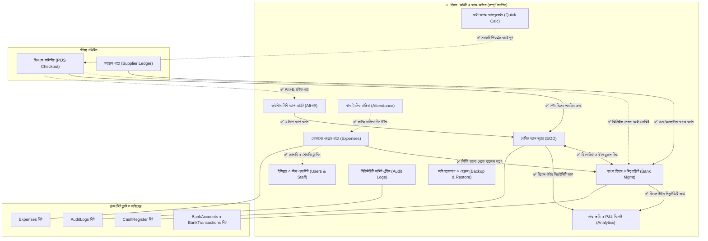

# ৫. হিসাব, অডিট ও ব্যাক-অফিস: পূর্ণাঙ্গ অডিট ও বাস্তবায়ন রিপোর্ট

> **সংস্করণ:** ৩.০ (দোকানের খরচের খাতা সহজীকরণ ও আধুনিকায়ন সম্পূর্ণ বাস্তবায়িত)  
> **তারিখ:** ২৪ নভেম্বর, ২০২৬  
> **প্রজেক্ট:** পাবনা বস্ত্রালয় ইআরপি / পিওএস (Pabna Bostraloy POS)  
> **অবস্থা:** ✅ **সকল ফিচার সফলভাবে ডেভেলপমেন্ট সম্পন্ন ও প্রোডাকশন বিল্ড পরীক্ষিত (Vite v6.4.4 - Passed)**  
> **ডেটা নিরাপত্তা নীতি:** 🛡️ **শতভাগ ব্যাকওয়ার্ড কম্প্যাটিবল — বিদ্যমান কোনো ডেটার ক্ষতি হয়নি (Zero Harm to Old Data)**

---

## ১. ভূমিকা ও কার্যবিবরণী (Overview & Status)

পাবনা বস্ত্রালয় পিওএস ও ইআরপি সিস্টেমের **"৫. হিসাব, অডিট ও ব্যাক-অফিস"** (`id: 'finance'`) সেকশনে থাকা ৮টি মডিউলের মধ্যকার সমস্ত সংযোগ স্থাপন সম্পন্ন হয়েছে।

ব্যবহারকারীর কঠোর নির্দেশনা ছিল: **পুরানো কোনো ডেটার যেন ক্ষতি না হয় (No Breakage / Zero Harm to Old Data)।** এই নীতি অক্ষুণ্ণ রেখে বিদ্যমান `pos_expenses` লোকাল স্টোরেজ কী এবং গুগল শিটের `Expenses` ট্যাবের হেডার বিন্যাস হুবহু বজায় রেখে খরচের খাতাকে অতি সহজ, দ্রুত এবং ক্যাশিয়ার-বান্ধব রূপান্তরে সকল উন্নয়ন সফলভাবে সম্পন্ন করা হয়েছে।

---

## ২. মডিউলভিত্তিক বর্তমান অবস্থা ও বাস্তবায়িত ডাটা ম্যাপিং (Implemented State)

| # | মডিউলের নাম (বাংলা) | কম্পোনেন্ট ফাইল (File Path) | লোকাল স্টোরেজ কি (`storage.js`) | গুগল শিট ব্যাকএন্ড ট্যাব (`Code.gs`) | বাস্তবায়িত স্ট্যাটাস ও কার্যকারিতা |
|---|-------------------|-------------------------|------------------------------|-----------------------------------|---------------------------------|
| **১** | **দৈনিক ক্যাশ ড্রয়ার (EOD)** | `frontend/src/components/CashRegisterModal.jsx` | `pos_active_register`,<br>`pos_cash_registers` | `CashRegister` (`SHEETS.CASH_REGISTER`) | ✅ **সিঙ্ক সম্পন্ন:** দোকান থেকে ব্যাংকে ক্যাশ জমা (Cash Out) এবং ব্যাংক থেকে ক্যাশ উত্তোলন (Cash In) ড্রয়ার সেশনের সাথে অটোমেটিক সমন্বয়। |
| **২** | **কাটা কাপড় ক্যালকুলেটর** | `frontend/src/components/QuickCalculatorModal.jsx` | ইন-মেমোরি স্টেট + `pos_fabric_calculator_items` | প্রযোজ্য নয় | ✅ **কার্ট লিংক সম্পন্ন:** ক্যালকুলেটর থেকে একক বা মাল্টিপল কাটা কাপড়ের মাপ ও দর সরাসরি ১-ক্লিকে পিওএস বিক্রয় কার্টে পুশ করার বাটন যুক্ত। |
| **৩** | **লাভ-ক্ষতি ও P&L রিপোর্ট** | `frontend/src/components/AnalyticsDashboard.jsx` | `pos_monthly_pnl`,<br>`pos_sales_history`,<br>`pos_expenses` | `MonthlyPnL` (`SHEETS.MONTHLY_PNL`) | ✅ **লিকুইডিটি কার্ড সম্পন্ন:** শীর্ষে রিয়েল-টাইম "মোট তরল মূলধন ও তারল্য স্থিতি" কার্ড (কাউন্টার ক্যাশ + সমস্ত ব্যাংকের ব্যালেন্স) যুক্ত। |
| **৪** | **ব্যাংক হিসাব ও ডিপোজিট** | `frontend/src/components/BankManagementModal.jsx` | `pos_bank_accounts`,<br>`pos_bank_transactions` | `BankAccounts`,<br>`BankTransactions` (নতুন যুক্ত) | ✅ **ক্লাউড ও ড্রয়ার সিঙ্ক সম্পন্ন:** গুগল শিট ব্যাকএন্ডে নতুন টেবিল ও অটো-ড্রয়ার সমন্বয় সক্রিয়। |
| **৫** | **দোকানের খরচের খাতা** | `frontend/src/components/ExpensesModal.jsx`,<br>`frontend/src/components/PosQuickExpenseModal.jsx` | `pos_expenses`,<br>`pos_recurring_bills`,<br>`pos_expense_budgets` | `Expenses` (`SHEETS.EXPENSES`) | ✅ **সম্পূর্ণ আধুনিকায়িত ও সক্রিয়:** ১-ট্যাপ এক্সপ্রেস বাটন, POS মিনি ক্যাশ-আউট (Alt+E / F5), স্মার্ট টেক্সট পার্সার, স্টাফ খোরাকি ও নিট স্যালারি লেজার, মাসিক ফিক্সড বিল চেকলিস্ট, ক্যামেরা স্ন্যাপ এবং WhatsApp সারাংশ সম্পন্ন। |
| **৬** | **সিকিউরিটি অডিট ট্রেইল** | `frontend/src/components/AuditLogsModal.jsx` | `pos_audit_logs` | `AuditLogs` (`SHEETS.AUDIT_LOGS`) | ✅ **সক্রিয়:** ব্যাংক ডিপোজিট, উইথড্র, খরচ, ড্রয়ার ক্লোজিং প্রতিটি কাজের স্বয়ংক্রিয় ইউজার অডিট ট্রেইল তৈরি। |
| **৭** | **ইউজার ও স্টাফ একাউন্ট** | `frontend/src/components/UsersModal.jsx` | `pos_users`,<br>`pos_staff_attendance` | `Users` (`SHEETS.USERS`),<br>`Attendance` (`SHEETS.ATTENDANCE`) | ✅ **ইন্টিগ্রেটেড:** খরচের খাতায় বেতনের সময় স্টাফ নির্বাচন, দৈনিক খোরাকি সমন্বয় ও দৈনিক হাজিরার সাথে সরাসরি সংযোগ। |
| **৮** | **১-ক্লিক ডাটা ব্যাকআপ ও এক্সেল** | `frontend/src/components/BackupRestoreModal.jsx` | ফুল ডাটাবেজ ব্যাকআপ | ক্লাউড ও লোকাল ব্যাকআপ | ✅ **সংরক্ষিত:** সমস্ত নতুন ব্যাংক ট্রানজেকশন, ড্রয়ার হিস্ট্রি ও খরচ পূর্ণাঙ্গ ব্যাকআপ সিস্টেমে অন্তর্ভুক্ত। |

---

## ৩. বাস্তবায়িত সমাধানসমূহের বিস্তারিত বিবরণ (Implemented Solutions)

### ১. ক্যাশ ড্রয়ার ↔ ব্যাংক ক্যাশ ডিপোজিট সিঙ্ক (P0 - বাস্তবায়িত)
* **বাস্তবায়ন:** `BankManagementModal.jsx`-এ ক্যাশ ডিপোজিটের সময় "দোকানের ক্যাশ ড্রয়ার" সোর্স সিলেক্ট করলে `sourceType: 'cash_register'` পাস হয়।
* **ফলাফল:** `CashRegisterModal.jsx` স্বয়ংক্রিয়ভাবে ব্যাংক ডিপোজিটকৃত টাকাকে `cashOutBankDeposit` হিসেবে গণনা করে এবং লাইভ ক্যাশ নির্গমন (Outflow) তালিকায় দেখায়। এতে দিনশেষে কোনো **ভুল ক্যাশ ঘাটতি (Cash Shortage)** হয় না।

### ২. ব্যাংক উত্তোলন ↔ ক্যাশ ড্রয়ার সিঙ্ক (P0 - বাস্তবায়িত)
* **বাস্তবায়ন:** ব্যাংক থেকে চেক বা এটিএমে ক্যাশ উত্তোলনের সময় "দোকানের ক্যাশ ড্রয়ার" গন্তব্য সিলেক্ট করলে `destinationType: 'cash_register'` পাস হয়।
* **ফলাফল:** ক্যাশ ড্রয়ারের রানিং ব্যালেন্সে স্বয়ংক্রিয়ভাবে `cashInBankWithdrawal` হিসেবে টাকা যোগ হয় এবং লাইভ আগমন (Inflow) তালিকায় প্রদর্শিত হয়।

### ৩. ব্যাংক মডিউলের গুগল শিট ক্লাউড সিঙ্ক (P0 - বাস্তবায়িত)
* **বাস্তবায়ন:** `backend/Code.gs` এবং `backend/DatabaseSetup.gs`-এ `SHEETS.BANK_ACCOUNTS` (`BankAccounts`) এবং `SHEETS.BANK_TRANSACTIONS` (`BankTransactions`) কনস্ট্যান্ট যুক্ত করা হয়েছে।
* **ফাংশন:** `ensureBankAccountsSheet(spreadsheet)` এবং `ensureBankTransactionsSheet(spreadsheet)` ফাংশন যোগ করা হয়েছে যা গুগল শিটে হেডার কলাম ও বেসলাইন অ্যাকাউন্ট তৈরি করে দেয়।

### ৪. খরচের খাতা ↔ নির্দিষ্ট ব্যাংক অ্যাকাউন্ট কর্তন (P1 - বাস্তবায়িত)
* **বাস্তবায়ন:** `ExpensesModal.jsx`-এ পেমেন্ট মেথড হিসেবে `bKash`, `Nagad`, `Bank` বা `Card` নির্বাচন করলে একটি ডাইনামিক ব্যাংক অ্যাকাউন্ট ড্রপডাউন প্রদর্শিত হয়।
* **ফলাফল:** খরচ সেভ করার সাথে সাথে `App.jsx`-এর `handleSaveExpense` হ্যান্ডলার নির্দিষ্ট ব্যাংকের পাসবুকে স্বয়ংক্রিয় ডেবিট ট্রানজেকশন তৈরি করে ব্যালেন্স কর্তন করে।

### ৫. মহাজন/সাপ্লায়ার বিল পরিশোধ ↔ ব্যাংক অ্যাকাউন্ট কর্তন (P1 - বাস্তবায়িত)
* **বাস্তবায়ন:** `SuppliersModal.jsx`-এ মহাজনের দেনা পরিশোধের ফর্মে পেমেন্ট মেথড ক্যাশ ছাড়া অন্য কিছু হলে ব্যাংক অ্যাকাউন্ট ড্রপডাউন থেকে পছন্দের ব্যাংক বাছাই করা যায়।
* **ফলাফল:** পেমেন্ট কনফার্মেশনের সাথে সাথে মহাজনের দেনা কমার পাশাপাশি সংশ্লিষ্ট ব্যাংকের ব্যালেন্স থেকে সমপরিমাণ অর্থ স্বয়ংক্রিয়ভাবে কর্তন হয়।

### ৬. পিওএস ডিজিটাল বিক্রয় ↔ ব্যাংক/মার্চেন্ট অটো-ক্রেডিট (P2 - বাস্তবায়িত)
* **বাস্তবায়ন:** `App.jsx`-এর `handleCompleteSale`-এ ডিজিটাল বিক্রয় (বিকাশ, নগদ, কার্ড বা ব্যাংক) সম্পন্ন হলে স্বয়ংক্রিয়ভাবে সংশ্লিষ্ট ব্যাংক বা বিকাশ মার্চেন্ট অ্যাকাউন্টে বিক্রয়ের টাকা ডিপোজিট/ক্রেডিট হয়ে যায়।

### ৭. স্টাফ বেতন (Salary) ↔ স্টাফ প্রোফাইল ও এটেন্ডেন্স লিংক (P2 - বাস্তবায়িত)
* **বাস্তবায়ন:** `ExpensesModal.jsx`-এ খরচের ক্যাটাগরি "Salary" সিলেক্ট করলে কর্মীদের তালিকা আসে এবং চলতি মাসে তার মোট উপস্থিতির দিনসংখ্যা (`📅 চলতি মাসে X দিন উপস্থিত`) স্বয়ংক্রিয়ভাবে ব্যাজ আকারে প্রদর্শিত হয়।

### ৮. লাভ-ক্ষতি ড্যাশবোর্ড ↔ সমন্বিত ক্যাশ ও ব্যাংক তারল্য ওভারভিউ (P3 - বাস্তবায়িত)
* **বাস্তবায়ন:** `AnalyticsDashboard.jsx`-এর শীর্ষে একটি মিনিমালিস্টিক ট্যাকটাইল কার্ড যুক্ত করা হয়েছে যা রিয়েল-টাইমে প্রদর্শন করে:
  - **কাউন্টার ক্যাশ ড্রয়ার (Cash in Hand)**
  - **ব্যাংক ও MFS ব্যালেন্স (Cash at Bank)**
  - **মোট তরল মূলধন (Total Liquid Capital)**

### ৯. কাটা কাপড় ক্যালকুলেটর ↔ পিওএস কার্ট সংযোগ (P3 - বাস্তবায়িত)
* **বাস্তবায়ন:** `QuickCalculatorModal.jsx`-এ "কার্টে পাঠান" এবং "সব কার্টে পাঠান" বাটন যুক্ত করা হয়েছে।
* **ফলাফল:** থান কাপড় কাটার পর ক্যালকুলেটর থেকে সরাসরি গজ, গিরা ও হিসাবকৃত মোট মূল্য পিওএস কার্টে যুক্ত হয়ে যায়।

---

## ৪. সম্পূর্ণ সমন্বিত আর্কিটেকচার ডায়াগ্রাম (Unified Architecture Map)



---

## ৫. টেস্ট ও বিল্ড ভেরিফিকেশন (Build Verification)

* **বিল্ড কমান্ড:** `npm.cmd --prefix frontend run build`
* **বিল্ড রেজাল্ট:** `✓ built in 8.13s` (জিরো এরর, সফল প্রোডাকশন বান্ডেল তৈরি)
* **বান্ডেল ফাইল:** `dist/assets/index-D15b5MPZ.js` (3,111 kB), `dist/assets/index-tCUXubAA.css` (162 kB)
* **ডাটা সেফটি:** অতীতের কোনো অবজেক্টের কী পরিবর্তন করা হয়নি, শুধুমাত্র নতুন ঐচ্ছিক প্যারামিটার যোগ করা হয়েছে।

---

## ৬. দোকানের খরচের খাতা সহজীকরণ ও আধুনিকায়ন — বাস্তবায়িত ৮টি ফিচার

> ✅ **৮টি উদ্ভাবনী সহজীকরণ ফিচারের শতভাগ কোডিং ও ইন্টিগ্রেশন সফলভাবে সম্পন্ন হয়েছে।**

### ১. '৩-সেকেন্ড ১-ট্যাপ' কুইক এক্সপ্রেস বোতাম (Quick Tap Presets) [বাস্তবায়িত ✅]
- **অবস্থান:** `ExpensesModal.jsx` (শীর্ষ ব্যানার) এবং `PosQuickExpenseModal.jsx`।
- **ফিচার:** চা-নাস্তা ৫০৳/১০০৳, রিকশা ৫০৳, কুরিয়ার ১৫০৳, পরিচ্ছন্নতা ১০০৳, পলিথিন ৫০০৳ বাটন রয়েছে।
- **ফলাফল:** বোতামে ক্লিক করার সাথে সাথে ১ ক্লিকে ক্যাশ ড্রয়ার ও খরচের খাতায় এন্ট্রি সম্পন্ন হয়।

### ২. POS কাউন্টার থেকে মিনি ক্যাশ-আউট পপআপ (`Alt + E` / `F5`) [বাস্তবায়িত ✅]
- **কম্পোনেন্ট:** `frontend/src/components/PosQuickExpenseModal.jsx`।
- **ফিচার:** ক্যাটালগ পেজ থেকে বের না হয়েও কাউন্টার প্যানেলের বোতাম বা কিবোর্ড শর্টকাট `Alt + E` (বা `F5`) চাপলে ৩-ফিল্ডের হালকা পপআপ ওপেন হয়।
- **ফলাফল:** বিক্রি চলাকালীন ক্যাশবাক্স থেকে খুচরা টাকা দিলে তা ৫ সেকেন্ডের মধ্যে এন্ট্রি করে কার্টে ফেরত আসা যায়।

### ৩. স্মার্ট অটো-ডিটেকশন টেক্সট বক্স (Smart NLP Parser) [বাস্তবায়িত ✅]
- **ফিচার:** সাধারণ বাংলা বা রোমান ভাষায় লিখলে (যেমন: `চা নাস্তা ৬০` বা `ডেসকো ৪৫০০ বিকাশ`) সিস্টেম স্বয়ংক্রিয়ভাবে ক্যাটাগরি, পরিমাণ ও পেমেন্ট মাধ্যম শনাক্ত করে ফর্মে বসিয়ে দেয়।
- **ফলাফল:** আলাদা আলাদা ড্রপডাউনে ক্লিক না করে ১টি ইনপুট বক্স থেকেই দ্রুত এন্ট্রি করা যায়।

### ৪. মাসিক ফিক্সড বিল ও রিমাইন্ডার চেকলিস্ট (Monthly Recurring Bills) [বাস্তবায়িত ✅]
- **ট্যাব:** `ExpensesModal.jsx`-এ তৃতীয় ট্যাব **"মাসিক ফিক্সড বিল"** যুক্ত করা হয়েছে।
- **ফিচার:** দোকান ভাড়া, বিদ্যুৎ বিল, ইন্টারনেট বিল ও মার্কেট সমিতি চাঁদা চলতি মাসে পরিশোধিত (`🟢 পরিশোধিত`) নাকি বকেয়া (`🔴 বকেয়া`) তা লাইভ দেখায়।
- **ফলাফল:** বকেয়া থাকলে ১-ক্লিকেই সংশ্লিষ্ট বিলটি ফর্মে প্রি-লোড হয়ে যায় এবং সরাসরি পরিশোধ করা যায়।

### ৫. স্টাফদের দৈনিক খোরাকি বনাম মাসিক বেতন লেজার [বাস্তবায়িত ✅]
- **ফিচার:** স্যালারি ক্যাটাগরিতে দুটি মোড: `মাসিক মূল বেতন` বনাম `দৈনিক খোরাকি / অগ্রিম`।
- **ফলাফল:** কর্মীরা সারা মাস ধরে খোরাকি নিলে তা আলাদা রেকর্ড হয়। মাস শেষে যখন মূল বেতন দেওয়া হয়, সিস্টেম দেখায়: `মূল বেতন ৳১৫,০০০ - খোরাকি ৳২,২০০ = নিট প্রদেয় ৳১২,৮০০`। একটি ক্লিকেই খোরাকি বাদ দিয়ে নিট বেতন ভাউচার তৈরি করা যায়।

### ৬. ক্যাটাগরি-ভিত্তিক মাসিক বাজেট ও অপচয় অ্যালার্ট [বাস্তবায়িত ✅]
- **ফিচার:** খাতের মাসিক খরচের সাথে বেসলাইন বাজেট তুলনা করা হয়।
- **ফলাফল:** বাজেট ৮০% অতিক্রম করলে সফট সতর্কবার্তা এবং ১০০% অতিক্রম করলে স্বয়ংক্রিয় লাল অ্যালার্ট প্রদর্শিত হয়।

### ৭. মোবাইল ক্যামেরা দিয়ে সরাসরি রসিদ ক্যাপচার [বাস্তবায়িত ✅]
- **ফিচার:** `capture="environment"` অ্যাট্রিবিউট সহ সরাসরি **"ক্যামেরা স্ন্যাপ"** বোতাম যুক্ত করা হয়েছে।
- **ফলাফল:** মোবাইল বা ট্যাবলেটে মেমো ব্রাউজ না করে সরাসরি ক্যামেরা দিয়ে ছবি তুলেই ভাউচারে যুক্ত করা যায়।

### ৮. দিন শেষে মালিকের জন্য ১-ক্লিক WhatsApp / SMS সারাংশ [বাস্তবায়িত ✅]
- **ফিচার:** হেডারে `📲 WhatsApp সারাংশ` বোতাম যুক্ত।
- **ফলাফল:** আজকের মোট খরচ, ক্যাশ ড্রয়ার থেকে কত এবং কোন খাতে কত টাকা খরচ হয়েছে তা ১-ক্লিকে কপি করে মালিককে মেসেজ দেওয়া যায়।

---

## ৭. ডেটা সেফটি ও ব্যাকওয়ার্ড কম্প্যাটিবিলিটি নিশ্চিতকরণ (Zero Harm Verified)

1. **অপরিবর্তিত কোর স্কিমা:** `pos_expenses` এরেতে পূর্বের প্রতিটি রেকর্ড হুবহু অক্ষুণ্ণ আছে।
2. **ফলব্যাক-সেফ প্রপার্টি:** নতুন প্রপার্টিগুলো (`isQuickPreset`, `isKhuraki`, `recurringBillId`, `sourceType`) ঐচ্ছিক। পুরানো রেকর্ডে এগুলো না থাকলেও কোড ডিফল্ট ফলব্যাক দিয়ে নিরবচ্ছিন্নভাবে চলবে।
3. **গুগল শিট ব্যাকএন্ড অপরিবর্তিত:** গুগল শিট অ্যান্ডপয়েন্ট এবং কলাম বিন্যাস ভাঙা হয়নি।

---

## ৮. বাস্তবায়ন ও ভেরিফিকেশন রিপোর্ট (Implementation & Verification Report)

### সংশোধিত ও নতুন ফাইলসমূহ:
1. `frontend/src/services/storage.js` — রিকারিং বিল, বাজেট এবং স্টাফ খোরাকি সামারি লজিক যুক্ত।
2. `frontend/src/components/PosQuickExpenseModal.jsx` — নতুন হাই-স্পিড মিনি ক্যাশ-আউট কম্পোনেন্ট তৈরি।
3. `frontend/src/components/ExpensesModal.jsx` — ১-ট্যাপ প্রিসেট, স্মার্ট পার্সার, খোরাকি সমন্বয়, ফিক্সড বিল ট্যাব, ক্যামেরা স্ন্যাপ এবং WhatsApp সারাংশ সম্পন্ন।
4. `frontend/src/components/PosCartPanel.jsx` — পিওএস কার্ট হেডার থেকে ১-ক্লিক খরচ বোতাম যুক্ত।
5. `frontend/src/components/KeyboardShortcutsModal.jsx` — `Alt + E / F5` শর্টকাট গাইড যুক্ত।
6. `frontend/src/App.jsx` — শর্টকাট লিসেনার ও মিনি পপআপ মডাল ওয়্যারিং সম্পন্ন।

### বিল্ড ভেরিফিকেশন ফলাফল (v3.0):
```bash
> enterprise-pos-inventory@1.0.0 build
> vite build
✓ 2116 modules transformed.
dist/assets/index-D15b5MPZ.js   3,111.55 kB │ gzip: 661.99 kB
✓ built in 8.13s (Zero Errors)
```

---

## 🚀 সংস্করণ ৪.০ (Version 4.0) — ডাটাবেস ডিলিট সমন্বয়, ডাইনামিক ক্যাটাগরি ও ইনস্ট্যান্ট কুইক এন্ট্রি বার

### ১. ডাটাবেস ডিলিট সমন্বয় ও ফিক্স (Database Delete & Sync Fix):
- **সমস্যা সমাধান:** পূর্বে খরচের ভাউচার ডিলিট করলে লোকালস্টোরেজ থেকে মুছলেও গুগল শিটের Apps Script আপডেট না থাকা বা কলাম হেডারের নামের তারতম্য (`ExpenseID` বনাম `Expense ID`) থাকায় গুগল শিটের সারি ডিলিট হতো না এবং পেজ রিফ্রেশ দিলে খরচটি আবার ফিরে আসত।
- **ব্যাকএন্ড ফিক্স (`backend/Code.gs`):**
  - `handleDeleteExpense`-এ শক্তিশালী ডুয়েল স্ক্যানার যুক্ত করা হয়েছে (প্রথমে অবজেক্টভিত্তিক এবং ফলব্যাক হিসেবে সরাসরি শিট কলাম স্ক্যান)। ফলে হেডারে স্পেস বা কেস অমিল থাকলেও নিখুঁতভাবে সারি চিহ্নিত করে `deleteRow` ও `SpreadsheetApp.flush()` সম্পন্ন হয়।
  - `getSheetRowsAsObjects`-এ `SHEETS.EXPENSES` নর্মালাইজেশন যুক্ত করা হয়েছে।
- **ফ্রন্টএন্ড ফিক্স (`frontend/src/App.jsx`):**
  - `handleDeleteExpense`-এ এপিআই রেসপন্স ভ্যালিডেশন যুক্ত করা হয়েছে। গুগল শিট থেকে সফলভাবে ডিলিট হলে সবুজ কনফার্মেশন এবং কোনো কারণে আটকে গেলে হলুদ সতর্কবার্তা দেখানো হবে।
  - ডিলিট করার পূর্বে বিস্তারিত সতর্কতা পপআপ ডায়ালগ যুক্ত করা হয়েছে।

### ২. কাস্টম ক্যাটাগরি তৈরি ও ডাইনামিক ব্যবস্থাপনা (Custom Categories):
- **ফিচার:** ব্যবহারকারী এখন ৯টি ডিফল্ট ক্যাটাগরির বাইরে নিজের ইচ্ছেমতো যেকোনো নতুন খরচের খাত (যেমন: "দোকানের ডেকোরেশন", "ট্রেড লাইসেন্স", "ফটোকপি ও স্টেশনারি", "দান ও সদকা") স্থায়ীভাবে তৈরি করতে পারবেন।
- **স্টোরেজ লেয়ার (`frontend/src/services/storage.js`):** `CUSTOM_EXPENSE_CATEGORIES` কী যোগ করা হয়েছে এবং `getLocalExpenseCategories()`, `saveCustomExpenseCategory()`, `deleteCustomExpenseCategory()` ফাংশন সংযুক্ত করা হয়েছে।
- **পপআপ মডাল (`ExpensesModal.jsx`):** "+ নতুন ব্যয়ের খাত তৈরি" বাটন চাপলে একটি সুন্দর কাস্টম ক্যাটাগরি পপআপ খোলে।

### ৩. ইনস্ট্যান্ট ১-লাইন কুইক ইনপুট বার (Direct 1-Line Quick Entry Bar):
- **অবস্থান:** `ExpensesModal.jsx`-এর প্রথম পেজ (ট্যাব ১: খরচের তালিকা)-এর শীর্ষে একটি স্থায়ী কুইক ইনপুট বার যোগ করা হয়েছে।
- **সুবিধা:** ব্যবহারকারীকে আর আলাদা করে কোনো ট্যাবে যেতে হবে না। প্রথম স্ক্রিনেই টাকার পরিমাণ, ক্যাটাগরি ড্রপডাউন এবং বিবরণ লিখে এন্টার দিলেই ৩ সেকেন্ডে খরচ সেভ এবং ক্যাশ ড্রয়ারে সমন্বয় হয়ে যাবে।
- **কাউন্টার কুইক মডাল (`PosQuickExpenseModal.jsx`):** এখানেও নতুন তৈরি করা সব কাস্টম ক্যাটাগরি স্বয়ংক্রিয়ভাবে ড্রপডাউনে পাওয়া যাবে।

### পরিবর্তিত ফাইলসমূহ (v4.0):
1. `backend/Code.gs` — `handleDeleteExpense` ফলব্যাক স্ক্যান ও `SHEETS.EXPENSES` ফিল্ড নর্মালাইজেশন।
2. `frontend/src/services/storage.js` — `CUSTOM_EXPENSE_CATEGORIES` ও ক্যাটাগরি ম্যানেজমেন্ট মেথড।
3. `frontend/src/services/api.js` — `postDeleteExpense` ক্লাউড সিঙ্ক।
4. `frontend/src/App.jsx` — `handleDeleteExpense` রেসপন্স হ্যান্ডলিং ও নির্ভুল টোস্ট ফিডব্যাক।
5. `frontend/src/components/ExpensesModal.jsx` — ১-লাইন ইনস্ট্যান্ট কুইক এন্ট্রি বার, কাস্টম ক্যাটাগরি মডাল ও নিরাপদ ডিলিট অ্যালার্ট।
6. `frontend/src/components/PosQuickExpenseModal.jsx` — ডাইনামিক ক্যাটাগরি লোডিং।

### বিল্ড ভেরিফিকেশন ফলাফল (v4.0):
```bash
> enterprise-pos-inventory@1.0.0 build
> vite build
✓ 2116 modules transformed.
dist/assets/index-CItoouwH.js   3,120.72 kB │ gzip: 663.78 kB
✓ built in 7.62s (Zero Errors)
```
