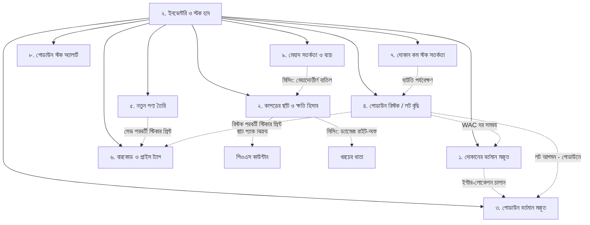
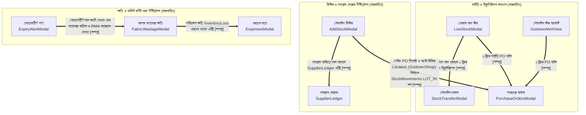

# ইনভেন্টরি ও স্টক হাব: পূর্ণাঙ্গ অডিট ও আর্কিটেকচারাল গাইডলাইন
**মডিউল গ্রুপ:** `২. ইনভেন্টরি ও স্টক হাব` (Inventory & Stock Hub)  
**সংস্করণ:** ২.০ (ডেভেলপমেন্ট ও ইন্টিগ্রেশন সম্পন্ন)  
**প্রথম সংস্করণ:** ২৩ নভেম্বর ২০২৬  
**সর্বশেষ আপডেট:** ২৩ নভেম্বর ২০২৬  
**অবস্থা:** বাস্তবায়ন সম্পন্ন ও পরীক্ষিত (Implemented & Verified) — নিরাপদ ও ব্যাকওয়ার্ড-কম্প্যাটিবল আর্কিটেকচার  

> [!NOTE]
> **v2.0 পরিবর্তনসমূহ:** ইনভেন্টরি ও স্টক হাবের সকল চিহ্নিত অপারেশনাল ও আর্থিক গ্যাপ (গ্যাপ ১, গ্যাপ ২, গ্যাপ ৩ [ক, খ, গ], গ্যাপ ৪, গ্যাপ ৫, গ্যাপ ৬) কোডে সফলভাবে বাস্তবায়িত হয়েছে। ডেটা ইন্টিগ্রিটি শতভাগ অক্ষুণ্ণ রেখে, বিদ্যমান ১০টি LocalStorage Key ও `fabricUtils` ভগ্নাংশ হিসাব সুরক্ষিত রেখে সিস্টেম সম্পূর্ণ ত্রুটিমুক্তভাবে বিল্ড (`vite build` সফল) করা হয়েছে।

---

## ১. পরিচিতি ও উদ্দেশ্য (Overview & Objective)

পাবনা বস্ত্রালয় ইআরপি সিস্টেমে **"২. ইনভেন্টরি ও স্টক হাব"** হলো কাপড়ের দোকান ও প্রধান গোডাউনের মালামাল নিয়ন্ত্রণকারী মূল ব্যাকবোন। এই হাবে মোট **৯টি মডিউল** অন্তর্ভুক্ত রয়েছে। 

এই দলিলের মূল উদ্দেশ্য হলো:
1. প্রতিটি মডিউলে বর্তমানে কী কী ডেটা ও ফিচার উপস্থিত রয়েছে তার পুঙ্খানুপুঙ্খ বিবরণ লিপিবদ্ধ করা।
2. বর্তমানে বিদ্যমান সক্রিয় সংযোগসমূহ (Active Inter-module Connections) নথিভুক্ত করা।
3. মডিউলগুলোর মধ্যে কোথায় কোথায় সংযোগ বিচ্ছিন্ন রয়েছে এবং কী কী ফিচার মিসিং আছে তার বিস্তারিত টেকনিক্যাল ম্যাপিং তৈরি করা।
4. ভবিষ্যতে ধাপে ধাপে ডেভেলপমেন্টের সময় যাতে কোনো তথ্য বাদ না পড়ে এবং পুরাতন কোনো ডেটা ক্ষতিগ্রস্ত না হয় তার জন্য একটি নির্ভুল গাইডলাইন প্রদান করা।

---

## ২. ইনভেন্টরি ও স্টক হাবের ৯টি মডিউলের বর্তমান ভূমিকা (Module Profiles)



### ১. দোকানের বর্তমান মজুত (`shop_stock`)
- **ফাইল/কম্পোনেন্ট:** `frontend/src/components/StockTransferModal.jsx` (`tab: 'shop_stock'`)
- **মূল কাজ:** 
  - দোকান বা কাউন্টার ফ্লোরের পণ্য ও কাপড়ের মজুত প্রদর্শন।
  - থান কাপড়ের ক্ষেত্রে থান, গজ এবং গিরার নিখুঁত ভগ্নাংশ রূপান্তর প্রদর্শন।
  - দোকান আউটফ্লো লেজার (Shop Outflow Ledger) এবং সেলস লগ পর্যবেক্ষণ।
  - Excel/CSV ফরম্যাটে তাৎক্ষণিক মজুত রিপোর্ট ডাউনলোড।

### ২. কাপড়ের ছাঁট ও ক্ষতি হিসাব (`fabric_wastage`)
- **ফাইল/কম্পোনেন্ট:** `frontend/src/components/FabricWastageModal.jsx`
- **ডাটা স্টোরেজ:** `pos_fabric_wastage` (LocalStorage) ও `StockMovements`
- **মূল কাজ:**
  - থান কাপড়ের কাটিংয়ের পর থেকে যাওয়া অবশিষ্টাংশ (End-of-bolt Remnants / ছাঁট) রেকর্ড করা।
  - ক্ষতিগ্রস্ত বা ত্রুটিপূর্ণ কাপড় (Damaged) ইনভেন্টরি থেকে আলাদা করা।
  - দোকান বা গোডাউনের মূল স্টক ও সংশ্লিষ্ট কালার ভ্যারিয়েন্ট থেকে পরিমাণ (গজ/থান) স্বয়ংক্রিয়ভাবে বিয়োগ করা।
  - `StockMovements` টেবিলে `WASTAGE` হিসেবে অডিট হিস্ট্রি সংরক্ষণ।
  - ছাঁট কাপড় দিয়ে `[ছাঁট প্যাক]` বা ক্লিয়ারেন্স বান্ডেল তৈরি করে পিওএস সেলস ক্যাটালগে যুক্ত করা।
  - বান্ডেলের জন্য বারকোড স্টিকার প্রিন্ট করা।

### ৩. গোডাউন বর্তমান মজুত (`godown_stock`)
- **ফাইল/কম্পোনেন্ট:** `frontend/src/components/StockTransferModal.jsx` (`tab: 'godown_stock'`)
- **মূল কাজ:**
  - প্রধান ওয়্যারহাউজ বা গোডাউনের অক্ষত মজুত প্রদর্শন (পাইকারি থান ও মোট গজ)।
  - গোডাউন থেকে দোকানে চালান পাঠানোর ইন্টারফেস (`Stock Transfers`)।
  - গোডাউন আউটফ্লো লেজার (Godown Outflow Ledger) ও স্টক ট্র্যাকিং।

### ৪. গোডাউন রিস্টক / লট বৃদ্ধি (`stock_restock`)
- **ফাইল/কম্পোনেন্ট:** `frontend/src/components/AddStockModal.jsx`
- **মূল কাজ:**
  - বিদ্যমান পণ্যে নতুন লট বা চালান যোগ করা (লোকেশন: দোকান কাউন্টার নাকি গোডাউন ওয়্যারহাউজ)।
  - পূর্বের অবশিষ্ট স্টক ও নতুন লটের ক্রয়মূল্যের সমন্বয়ে ওয়েটেড এভারেজ কস্ট (Weighted Average Cost - WAC) স্বয়ংক্রিয়ভাবে পুনঃগণনা করা।
  - সরবরাহকারী (মহাজন) বাছাই বা নতুন মহাজন যুক্ত করার সুবিধা।
  - নতুন লটের জন্য বারকোড স্টিকার প্রিন্ট সুবিধা।

### ৫. নতুন পণ্য তৈরি (`add_product`)
- **ফাইল/কম্পোনেন্ট:** `frontend/src/components/AddProductModal.jsx`
- **মূল কাজ:**
  - সম্পূর্ণ নতুন এসকেইউ (SKU) বা থান কোড তৈরি করা।
  - অটো-বারকোড জেনারেশন এবং ডুপ্লিকেট বারকোড সংঘর্ষ রোধ।
  - একাধিক ভ্যারিয়েন্ট (রং, সাইজ), থান প্রতি গজ, প্রারম্ভিক স্টক ও প্রারম্ভিক দাম নির্ধারণ।
  - ক্যামেরা দিয়ে পণ্যের ছবি তোলা এবং গুগল ড্রাইভে আপলোড।
  - সেভ পরবর্তী বারকোড স্টিকার প্রিন্ট অপশন (`autoPrintStickersOnSave` চেকবক্স)।

### ৬. বারকোড ও প্রাইস ট্যাগ (`barcode_print`)
- **ফাইল/কম্পোনেন্ট:** `frontend/src/components/BarcodePrintModal.jsx`
- **মূল কাজ:**
  - থার্মাল ও সাধারণ স্টিকার প্রিন্টারের জন্য বারকোড ও প্রাইস ট্যাগ লেবেল তৈরি।
  - বিভিন্ন মাপের লেবেল সাপোর্ট (৫০x৩০ মিমি, ৪০x২৫ মিমি, ৩৮x২৫ মিমি এবং A4 শিট)।
  - একক পণ্য বা পুরো ক্যাটালগ থেকে নির্বাচন করে বাল্ক ব্যাচ প্রিন্টিং।
  - `initialProductId` prop-এর মাধ্যমে বাইরে থেকে পণ্য প্রাক-সিলেক্ট করে সরাসরি ওপেন করার ক্ষমতা।
- **বিদ্যমান বিচ্ছিন্নতা (v1.1 সংযোজন):**
  - `BarcodePrintModal` থেকে `AddProductModal` বা `AddStockModal`-এ সরাসরি যাওয়ার কোনো শর্টকাট নেই। অর্থাৎ, বারকোড প্রিন্ট করার সময় যদি দেখা যায় কোনো পণ্যের দাম পরিবর্তন হওয়া দরকার, তবে আলাদাভাবে পণ্য সম্পাদনায় যেতে হয়।

### ৭. দোকান কম স্টক সতর্কতা (`low_stock_alerts`)
- **ফাইল/কম্পোনেন্ট:** `frontend/src/components/LowStockModal.jsx`
- **মূল কাজ:**
  - দোকানে যেসব পণ্যের মজুত নির্ধারিত নিরাপদ সীমার নিচে নেমে গেছে (`StockQuantity <= MinStockAlert`) তাদের ফিল্টার করা।
  - **৪টি KPI মেট্রিক্স** একসাথে প্রদর্শন:
    - `outOfStockCount` — সম্পূর্ণ স্টক শূন্য পণ্যের সংখ্যা
    - `criticalLowCount` — বিপজ্জনক সীমায় থাকা পণ্যের সংখ্যা
    - `totalDeficitUnits` — মোট ঘাটতি ইউনিট (নিরাপদ লেভেলে পৌঁছাতে কতটুকু লাগবে)
    - `totalRestockBudget` — প্রয়োজনীয় মোট বাজেট (ক্রয়মূল্য অনুযায়ী)
  - **৩টি টাইপ ফিল্টার:** `ALL`, `OUT_OF_STOCK`, `LOW_STOCK`
  - **৪টি সর্টিং মোড:** `STOCK_ASC` (সবচেয়ে কম স্টক আগে), `DEFICIT_DESC` (সবচেয়ে বেশি ঘাটতি আগে), `PRICE_DESC` (দামে বড় থেকে ছোট), `NAME_ASC` (নাম অনুযায়ী)
  - **ক্যাটাগরি ফিল্টার:** ক্যাটাগরি অনুযায়ী আলাদা করে দেখার সুবিধা।
  - **অ্যাকশন বাটন:** "Quick Restock" (যা `AddStockModal` খোলে) এবং "Add to Cart" (ক্লিয়ারেন্সের জন্য পিওএস কার্টে পাঠায়)।

### ৮. গোডাউন স্টক অ্যালার্ট (`godown_low_stock`)
- **ফাইল/কম্পোনেন্ট:** `frontend/src/components/GodownStockAlertView.jsx`
- **মূল কাজ:**
  - গোডাউনে যেসব পণ্যের মূল স্টক বা নির্দিষ্ট কোনো ভ্যারিয়েন্ট শেষ হয়ে গেছে তাদের তালিকা প্রদর্শন।
  - নির্দিষ্ট কালার বা সাইজের মজুত বিশ্লেষণ (যেমন: নীল রং শেষ, লাল আছে)।
  - মহাজনকে পাঠানোর উপযোগী রি-অর্ডার তালিকা PDF এবং Excel ফাইলে ডাউনলোড করা।

### ৯. মেয়াদ সতর্কতা ও ব্যাচ (`expiry_alerts`)
- **ফাইল/কম্পোনেন্ট:** `frontend/src/components/ExpiryAlertModal.jsx`
- **মূল কাজ:**
  - ব্যাচ নম্বর ও মেয়াদের তারিখ অনুযায়ী ঝুঁকিপূর্ণ পণ্য পর্যবেক্ষণ।
  - সেগমেন্টেশন: মেয়াদ শেষ (Expired), ৭ দিন বাকি, ১৫ দিন বাকি, ৩০ দিন বাকি।
  - মেয়াদোত্তীর্ণ পণ্যের কারণে সম্ভাব্য আর্থিক ক্ষতি (Expired Loss Amount) গণনা।
  - অ্যাকশন: ক্লিয়ারেন্স সেলের জন্য কার্টে যোগ করা ও পণ্যের তথ্য সম্পাদনা করা।

---

## ৩. বর্তমানে কার্যকর আন্তঃমডিউল সংযোগসমূহ (Existing Active Relationships)

1. **দোকান ↔ গোডাউন চালান ও স্টক স্থানান্তর:**
   - গোডাউন থেকে দোকানে চালান পাঠালে গোডাউন স্টক কমে এবং ট্রানজিট (পথে থাকা) স্টকে জমা হয়। দোকানদার চালান রিসিভ করলে দোকানের স্টকে যোগ হয় এবং `StockMovements` টেবিলে `TRANSFER_OUT` ও `TRANSFER_IN` সংরক্ষিত হয়।
2. **কাপড়ের ছাঁট ↔ পিওএস ক্যাটালগ সিঙ্ক:**
   - ছাঁট কাপড়ের ক্লিয়ারেন্স বান্ডেল তৈরি করলে তা সরাসরি পিওএস ক্যাটালগে `[ছাঁট প্যাক]` হিসেবে স্টকে জমা হয় এবং কাউন্টারে বিক্রি হওয়া মাত্রই ছাঁটের টেবিলে স্ট্যাটাস `Sold` হয়ে যায়।
3. **রিস্টক ↔ ক্রয়মূল্য পুনঃগণনা (WAC):**
   - নতুন লটের কাপড় বা পণ্য যোগ করার সময় পুরনো অবিক্রিত স্টক ও নতুন কেনার দরের গাণিতিক সমন্বয়ে পণ্যের গড় ক্রয়মূল্য (`CostPrice`) রিয়েল-টাইমে আপডেট হয়।
4. **পিওএস ক্যাশ কাউন্টার ↔ দোকানের স্টক কর্তন:**
   - কাউন্টারে বিক্রি সম্পন্ন হলে মেমো অনুযায়ী দোকান ও সংশ্লিষ্ট ভ্যারিয়েন্টের গজ/পিস তাৎক্ষণিক হ্রাস পায়।
5. **কাস্টমার রিটার্ন ↔ স্টক পুনরুদ্ধার:**
   - কাস্টমার সেলস রিটার্নে মাল ভালো থাকলে সঙ্গে সঙ্গে দোকানের স্টকে ফেরত আসে।
6. **নতুন পণ্য ও রিস্টক ↔ বারকোড প্রিন্টার সংযোগ:**
   - `AddProductModal`-এ `autoPrintStickersOnSave` চেকবক্স এবং `AddStockModal`-এ `autoPrintStickersOnRestock` চেকবক্স সক্রিয় থাকলে সেভ/রিস্টক শেষে `BarcodeStickerModal` স্বয়ংক্রিয়ভাবে চালু হয়।

---

## ৪. চিহ্নিত মিসিং সংযোগ ও সমাধানকৃত আর্কিটেকচার (Resolved Gaps & Implemented Connections)



### গ্যাপ ১ [বাস্তবায়িত ও সমাধানকৃত]: দোকান কম স্টক (`LowStockModal`) ↔ গোডাউন চালান রিকুইজিশন ডিসকানেক্ট
- **পূর্বের সমস্যা:** দোকানে স্টক কমে গেলে (`StockQuantity <= MinStockAlert`), গোডাউনে মাল আছে কিনা তা দেখার জন্য আলাদা ট্যাবে যেতে হতো এবং সেখান থেকে ১-ক্লিকে গোডাউন-টু-শপ চালানের রিকুইজিশন তৈরি করার কোনো সুবিধা ছিল না।
- **বাস্তবায়িত সমাধান ও টেকনিক্যাল মেকানিজম:**
  - `frontend/src/components/LowStockModal.jsx`-এ প্রতিটি পণ্যের জন্য রিয়েল-টাইম `GodownStock` লাইভ ব্যাজ প্রদর্শন করা হয়েছে।
  - যদি `GodownStock > 0` হয়, তবে হাইলাইটেড **"গোডাউন চালান"** বাটন যুক্ত করা হয়েছে।
  - বাটনে ক্লিক করলে `onRequestStockTransfer` প্রপের মাধ্যমে `StockTransferModal` ওপেন হয় এবং `from: 'godown'`, `to: 'shop'`, পণ্য নির্বাচন ও ঘাটতি পরিমাণ প্রাক-পূরণ হয়ে যায়।

### গ্যাপ ২ [বাস্তবায়িত ও সমাধানকৃত]: কম স্টক অ্যালার্ট (`LowStockModal` & `GodownStockAlertView`) ↔ ১-ক্লিক পারচেজ অর্ডার (PO) ডিসকানেক্ট
- **পূর্বের সমস্যা:** দোকান ও গোডাউন উভয় স্থানেই স্টক ০ (`Out of Stock`) হলে মহাজনকে অর্ডার দেওয়ার জন্য ম্যানুয়ালি পারচেজ অর্ডার মডালে গিয়ে আইটেম যুক্ত করতে হতো।
- **বাস্তবায়িত সমাধান ও টেকনিক্যাল মেকানিজম:**
  - `LowStockModal.jsx`-এ ঘাটতি আইটেমের পাশে **"মহাজন PO"** কুইক বাটন যোগ করা হয়েছে।
  - `GodownStockAlertView.jsx`-এ অ্যাকশন কলাম যোগ করে **"PO দিন"** এবং **"রিস্টক"** বাটন যুক্ত করা হয়েছে।
  - বাটনে ক্লিক করলে `onRequestPO` হ্যান্ডলার সক্রিয় হয়ে `prefilledPOProduct` স্টেট সেট করে এবং `PurchaseOrdersModal` ওপেন হয়ে সংশ্লিষ্ট পণ্য, প্রস্তাবিত ঘাটতি পরিমাণ ও শেষ ক্রয়মূল্য স্বয়ংক্রিয়ভাবে ড্রাফট আইটেম হিসেবে লোড করে।

### গ্যাপ ৩ [বাস্তবায়িত ও সমাধানকৃত]: গোডাউন রিস্টক (`AddStockModal`) ↔ পেন্ডিং পারচেজ অর্ডার (PO) সিঙ্ক মিসিং — ৩টি উপ-সমস্যার পূর্ণ সমাধান
- **উপ-সমস্যা ক সমাধান:** `frontend/src/components/AddStockModal.jsx`-এ সেকশন ১ এর উপরে **"পেন্ডিং পারচেজ অর্ডার (PO) থেকে মাল গ্রহণ করুন"** সিলেক্টর ড্রপডাউন যুক্ত করা হয়েছে। ড্রপডাউন থেকে পেন্ডিং PO সিলেক্ট করলে সরবরাহকারী, পণ্য, পরিমাণ ও একক দর স্বয়ংক্রিয়ভাবে বসে যায় এবং `linkedPONumber` সংরক্ষিত হয়। স্টক রিসিভ সম্পন্ন হলে `App.jsx`-এ `handleSubmitStock` হ্যান্ডলারে সংশ্লিষ্ট PO স্ট্যাটাস স্বয়ংক্রিয়ভাবে `Received` হয়ে ক্লোজ হয়ে যায়।
- **উপ-সমস্যা খ সমাধান:** `App.jsx`-এর `handleUpdatePOStatus` এবং `handleSubmitStock`-এ PO রিসিভ করার সময় `recordStockMovementLocally` কল করে `LOT_IN` টাইপ অডিট লগ বাধ্যতামূলকভাবে সংরক্ষণ করা হয়েছে। ফলে স্টক হিস্ট্রিতে লট আগমন দৃশ্যমান।
- **উপ-সমস্যা গ সমাধান:** `PurchaseOrdersModal.jsx`-এ PO ড্রাফট তৈরির সময় এবং পেন্ডিং PO টেবিলে "স্টক ইন" ক্লিক করার সময় লোকেশন অপশন মোডাল (`Godown` বনাম `Shop`) যুক্ত করা হয়েছে। ব্যবহারকারীর নির্বাচন অনুযায়ী `App.jsx` যথাক্রমে `GodownStock` (ও কেস-কম্প্যাটিবল `godownStock`) অথবা `StockQuantity`-তে নতুন লট যোগ করে এবং WAC হিসাব করে।

### গ্যাপ ৪ [বাস্তবায়িত ও সমাধানকৃত]: গোডাউন রিস্টক (`AddStockModal`) ↔ মহাজন লেজার ও দেনা (Accounts Payable) সংযোগ বিচ্ছিন্ন
- **পূর্বের সমস্যা:** মহাজন থেকে বাকিতে লট কিনলে ইনভেন্টরি স্টক ও WAC আপডেট হলেও মহাজন লেজারে কোনো প্রদেয় বিলের এন্ট্রি হতো না।
- **বাস্তবায়িত সমাধান ও টেকনিক্যাল মেকানিজম:**
  - `AddStockModal.jsx`-এ **সেকশন ৪: পেমেন্ট মোড ও মহাজন বাকি সমন্বয়** যুক্ত করা হয়েছে (`পরিশোধিত` বনাম `মহাজন বাকি (Payable Bill)`)।
  - পরিশোধের মাধ্যম (ক্যাশ, ব্যাংক, বিকাশ ইত্যাদি), প্রদত্ত টাকা ও বাকি টাকা রিয়েল-টাইমে ইনপুট নেওয়া হয়।
  - `App.jsx`-এ `handleSubmitStock`-এ বাকি থাকলে `saveSupplierLedgerEntryLocally` দিয়ে সরবরাহকারীর লেজারে `PURCHASE_BILL` এন্ট্রি হয় এবং সরবরাহকারীর `CurrentPayable` বৃদ্ধি পায়। ক্যাশ পরিশোধ থাকলে সংশ্লিষ্ট পেমেন্ট রেকর্ড লিপিবদ্ধ হয়।

### গ্যাপ ৫ [বাস্তবায়িত ও সমাধানকৃত]: কাপড়ের নষ্ট/ড্যামেজ ক্ষতি (`FabricWastageModal`) ↔ খরচের খাতা ও লাভ-ক্ষতি (Expense Loss Write-off) মিসিং
- **পূর্বের সমস্যা:** কাপড়ের ড্যামেজ রেকর্ড করলে কাপড়ের স্টক কমলেও ব্যয়ের খাতায় কোনো ক্ষতি নথিভুক্ত হতো না।
- **বাস্তবায়িত সমাধান ও টেকনিক্যাল মেকানিজম:**
  - `frontend/src/services/storage.js`-এ ব্যয়ের ক্যাটাগরিতে নতুন ক্যাটাগরি `InventoryLoss` (ইনভেন্টরি অপচয় ও ড্যামেজ ক্ষতি) যুক্ত করা হয়েছে।
  - `FabricWastageModal.jsx`-এ এন্ট্রি টাইপ `Damaged` হলে *"📉 পরিচালন ক্ষতি (Loss Write-Off) হিসেবে ব্যয়ের খাতায় অন্তর্ভুক্ত করুন"* চেকবক্স ও আনুমানিক ক্ষতির বিবরণী প্রদর্শিত হয়।
  - সেভ করার সময় `App.jsx`-এর `handleRecordFabricWastage`-এ চেকবক্স সক্রিয় থাকলে স্বয়ংক্রিয়ভাবে `saveOrUpdateExpenseLocally` কল হয় এবং নন-ক্যাশ ভাউচার তৈরি হয়ে প্রফিট-লস রিপোর্টে পরিচালন ক্ষতি হিসেবে রেকর্ড হয়।

### গ্যাপ ৬ [বাস্তবায়িত ও সমাধানকৃত]: মেয়াদোত্তীর্ণ পণ্য (`ExpiryAlertModal`) ↔ ড্যামেজ রাইট-অফ ও মহাজন রিটার্ন (RMA) লিংক মিসিং
- **পূর্বের সমস্যা:** মেয়াদোত্তীর্ণ পণ্যে তখনও "কার্টে নিন" সক্রিয় থাকত এবং ড্যামেজে সরানো বা মহাজনকে ফেরতের কোনো বাটন ছিল না।
- **বাস্তবায়িত সমাধান ও টেকনিক্যাল মেকানিজম:**
  - `ExpiryAlertModal.jsx`-এ যেসব পণ্যের স্ট্যাটাস `EXPIRED`, সেগুলোর জন্য "কার্টে নিন" বাটন অক্ষম (Disabled) করা হয়েছে যাতে ভুলবশত মেয়াদোত্তীর্ণ কাপড় বা পণ্য বিক্রি না হয়।
  - এর পাশাপাশি দুটি সক্রিয় অ্যাকশন বাটন যুক্ত করা হয়েছে:
    1. **"ড্যামেজ বাতিল"** বাটন: ক্লিকে `onWriteOffDamage` কল করে ড্যামেজ ক্ষতি মডাল খোলে।
    2. **"মহাজনে ফেরত (RMA)"** বাটন: ক্লিকে `onReturnToSupplier` কল করে সংশ্লিষ্ট মহাজনের কাছে রিটার্ন প্রক্রিয়া শুরু করে।

### গ্যাপ ৭ [ভবিষ্যৎ পরিকল্পনা - P3]: ফিজিক্যাল স্টক অডিট ও ভেরিয়েন্স রিকনসিলিয়েশন (Physical Stock Taking Gap)
- **পরিকল্পনা বিবরণ:** সরেজমিনে গণনা করে সিস্টেমের সাথে অমিল (Shortage/Surplus) বের করার জন্য একটি আলাদা ভ্যারিয়েন্স মডিউল। এটি পর্যায়ক্রমে বাস্তবায়ন করা হবে।

---

## ৫. অগ্রাধিকারভিত্তিক কর্মপরিকল্পনা ও বাস্তবায়ন স্ট্যাটাস (Implementation Roadmap & Status)

| অগ্রাধিকার | মিসিং ফিচারের নাম | সংশ্লিষ্ট গ্যাপ | স্ট্যাটাস | বাস্তবায়নের ফলাফল |
|:---:|---|:---:|:---:|---|
| **P0 (সর্বোচ্চ)** | **দোকান কম স্টক ↔ গোডাউন চালান রিকুইজিশন তৈরি** | গ্যাপ ১ | ✅ **সম্পন্ন (Done)** | কম স্টক মডালে গোডাউন স্টক প্রদর্শন ও ১-ক্লিকে ট্রান্সফার মডাল ওপেন। |
| **P0 (সর্বোচ্চ)** | **গোডাউন রিস্টক ↔ পেন্ডিং PO ক্লোজ, Location ও StockMovements সিঙ্ক** | গ্যাপ ৩ (ক, খ, গ) | ✅ **সম্পন্ন (Done)** | রিস্টকে পেন্ডিং PO রিসিভ, লোকেশন নির্বাচন ও LOT_IN অডিট লগ কার্যকর। |
| **P0 (সর্বোচ্চ)** | **রিস্টক ↔ মহাজন লেজারে বাকি বিল এন্ট্রি** | গ্যাপ ৪ | ✅ **সম্পন্ন (Done)** | বাকিতে লট আনলে মহাজনের দেনা বৃদ্ধি ও লেজারে স্বয়ংক্রিয় বিল এন্ট্রি। |
| **P1 (উচ্চ)** | **কম স্টক ও গোডাউন স্টক অ্যালার্ট থেকে ১-ক্লিক পারচেজ অর্ডার (PO)** | গ্যাপ ২ | ✅ **সম্পন্ন (Done)** | দোকান ও গোডাউন অ্যালার্ট থেকে সরাসরি প্রি-ফিল্ড PO ড্রাফট জেনারেশন। |
| **P1 (উচ্চ)** | **কাপড়ের ড্যামেজ ক্ষতি ↔ ব্যয়ের খাতায় অপচয় ক্ষতি (Write-off) এন্ট্রি** | গ্যাপ ৫ | ✅ **সম্পন্ন (Done)** | ড্যামেজ কাপড় কাটলে ব্যয়ের খাতায় `InventoryLoss` ভাউচার তৈরি। |
| **P2 (মাঝারি)** | **মেয়াদোত্তীর্ণ পণ্য ↔ ড্যামেজ রাইট-অফ ও মহাজন রিটার্ন (RMA)** | গ্যাপ ৬ | ✅ **সম্পন্ন (Done)** | মেয়াদোত্তীর্ণ পণ্য বিক্রি রোধ, ড্যামেজ এন্ট্রি ও মহাজন রিটার্ন বাটন যুক্ত। |
| **P3 (ভবিষ্যৎ)** | **বাস্তব স্টক গণনা ও অমিল সমন্বয় (Physical Stock Reconciliation)** | গ্যাপ ৭ | ⏳ **পরিকল্পনাধীন** | সরেজমিনে ফিজিক্যাল গণনা ও ভ্যারিয়েন্স অডিট মডিউল। |

---

## ৬. ডেটা ইন্টিগ্রিটি ও নিরাপত্তা নির্দেশিকা (Data Integrity Guidelines)

> [!IMPORTANT]
> ভবিষ্যতে যখন ডেভেলপমেন্ট শুরু করা হবে, তখন নিচের **সকল নিয়ম শতভাগ মেনে চলা বাধ্যতামূলক।** এর যে কোনোটি লঙ্ঘন করলে পুরানো ডেটা নষ্ট হওয়ার আশঙ্কা থাকবে।

### ৬.১ প্রোডাক্ট ফিল্ড ব্যাকওয়ার্ড কম্প্যাটিবিলিটি
বর্তমান পণ্যের কোনো ফিল্ড রিনেম বা মোছা যাবে না। সংরক্ষিত ফিল্ডসমূহ:

| ফিল্ডের নাম | উদ্দেশ্য |
|---|---|
| `ProductID` | পণ্যের অনন্য শনাক্তকারী |
| `Barcode` | বারকোড স্ক্যানার শনাক্তকারী |
| `StockQuantity` | দোকান ফ্লোরের বর্তমান মজুদ |
| `GodownStock` / `godownStock` | গোডাউনের বর্তমান মজুদ (উভয় case সংরক্ষণ) |
| `CostPrice` | ওয়েটেড এভারেজ ক্রয়মূল্য |
| `SellingPrice` | বিক্রয়মূল্য |
| `Variants` / `VariantsJSON` | ভ্যারিয়েন্ট অ্যারে ও JSON স্ট্রিং |
| `YardsPerThan` / `yardsPerThan` | থান প্রতি গজের মান (উভয় case সংরক্ষণ) |
| **`VariantID`** | **ভ্যারিয়েন্ট শনাক্তকারী (v1.1 সংযোজন — সব ভ্যারিয়েন্ট অপারেশনে এটি ব্যবহার করতে হবে)** |

### ৬.২ কাপড়ের ভগ্নাংশ হিসাব অক্ষুণ্ণ রাখা
- গজ ও গিরার সংজ্ঞা (`fabricUtils.js` লাইন ৩–৪ অনুযায়ী):
  - **`১ গজ = ১৬ গিরা = ৩৬ ইঞ্চি`**
  - **`১ গিরা = ১/১৬ গজ = ০.০৬২৫ গজ = ২.২৫ ইঞ্চি`**
- থান থেকে গজের রূপান্তর সবসময় `fabricUtils.js`-এর `parseGojGira()`, `calculateTotalYards()` ও `calculateInitialShopYards()` ফাংশন দিয়ে পরিচালনা করতে হবে।
- কখনো সরাসরি `* 16` বা `/ 16` দিয়ে ম্যানুয়াল ভগ্নাংশ গণনা করা যাবে না।

### ৬.৩ LocalStorage Key নাম অপরিবর্তনীয় (v1.1 সংযোজন)
নিচের LocalStorage Key নামগুলো পরিবর্তন বা মোছা যাবে না। এগুলো পরিবর্তন করলে বিদ্যমান সকল ব্যবহারকারীর সব ডেটা হারিয়ে যাবে:

| LocalStorage Key | কী ডেটা ধারণ করে |
|---|---|
| `pos_products` | পণ্যের পুরো ক্যাটালগ |
| `pos_fabric_wastage` | কাপড়ের ছাঁট ও ড্যামেজ রেকর্ড |
| `pos_stock_movements` | সকল স্টক মুভমেন্ট লগ |
| `pos_stock_transfers` | গোডাউন-দোকান চালানের রেকর্ড |
| `pos_purchase_orders` | পারচেজ অর্ডারের তালিকা |
| `pos_suppliers` | মহাজন/সরবরাহকারীর তালিকা |
| `pos_supplier_ledger` | মহাজন লেজারের হিসাব |
| `pos_expenses` | দোকানের খরচের রেকর্ড |
| `pos_sales` | বিক্রয় ইতিহাস |
| `pos_sales_returns` | কাস্টমার রিটার্ন রেকর্ড |

### ৬.৪ লোকালস্টোরেজ ও গুগল শিট সিঙ্ক নিশ্চয়তা
যে কোনো স্টক মুভমেন্ট বা রিস্টক সম্পন্ন হলে লোকালস্টোরেজ আপডেটের পাশাপাশি গুগল শিট ব্যাকএন্ডের `SHEETS.PRODUCTS`, `SHEETS.STOCK_MOVEMENTS` ও `SHEETS.FABRIC_WASTAGE`-এ লাইভ সিঙ্ক বজায় রাখতে হবে।

### ৬.৫ অডিট ট্রেইল বাধ্যতামূলক
যে কোনো স্টক স্থানান্তর, ড্যামেজ বা রিস্টকের ক্ষেত্রে ব্যবহারকারীর আইডি ও নামসহ `logAuditEventLocally` নিশ্চিত করতে হবে।

---

*ডকুমেন্ট সংস্করণ ১.১ — কারেকশন ও পরিমার্জন সমাপ্ত। এই দলিলের উপর ভিত্তি করে ব্যবহারকারীর অনুমোদনক্রমে ধাপে ধাপে পরবর্তী বাস্তবায়ন পরিচালনা করা হবে।*


---

## ৭. ভবিষ্যৎ উন্নত ফিচার পরিকল্পনা (Future Advanced Features Roadmap)

> [!NOTE]
> এই সেকশনে বিদ্যমান ৭টি গ্যাপের **বাইরে** সম্পূর্ণ নতুন ও উন্নত ফিচারের পরিকল্পনা নথিভুক্ত করা হয়েছে। এগুলো বাস্তবায়নের সময় ধাপ ৪ ও ৫ (গ্যাপ সমাধান)-এর পরে নেওয়া বাঞ্ছনীয়। **এখন কোনো ডেভেলপমেন্ট করা হয়নি।**

---

### ৭.১ স্মার্ট অ্যানালিটিক্স ও ইন্টেলিজেন্স বিভাগ

#### ✦ বিক্রয়-ভিত্তিক চাহিদা পূর্বাভাস (Demand Forecasting)
- **বিবরণ:** প্রতিটি কাপড় বা পণ্যের গত ৩০/৬০/৯০ দিনের বিক্রয়-গতি (`Sales Velocity`) বিশ্লেষণ করে ভবিষ্যতে কতটুকু লাগতে পারে তার স্বয়ংক্রিয় পূর্বাভাস।
- **উদাহরণ:** "নীল কটন থান প্রতি সপ্তাহে গড়ে ৮ গজ বিক্রি হয়। বর্তমান স্টক ১৮ গজ → আগামী ২২ দিনের মধ্যে শেষ হবে। এখনই অর্ডার দিন।"
- **সংশ্লিষ্ট মডিউল:** `shop_stock` (Sales data) → `low_stock_alerts` → `PurchaseOrders`
- **বাস্তবায়ন নির্দেশিকা:** বিদ্যমান `StockMovements` ও Sales লগ থেকে গড় দৈনিক বিক্রয় (`avgDailySales`) গণনা করতে হবে। কোনো ML বা বাহ্যিক API ছাড়াই LocalStorage ডেটা থেকে সম্ভব।
- **অগ্রাধিকার:** 🔴 **P0 (নতুন)**

#### ✦ ABC বিশ্লেষণ ড্যাশবোর্ড (ABC Analysis)
- **বিবরণ:** বিক্রয় অবদান অনুযায়ী পণ্যকে তিন ভাগে ভাগ করা:
  - **A শ্রেণি:** মোট বিক্রির ৭০% আনে এমন শীর্ষ পণ্য → সর্বোচ্চ মনোযোগ ও নিরাপদ স্টক।
  - **B শ্রেণি:** মোট বিক্রির ২০% আনে এমন মাঝারি পণ্য → স্বাভাবিক নজরদারি।
  - **C শ্রেণি:** মোট বিক্রির ১০% আনে এমন ধীরগতির পণ্য → ক্লিয়ারেন্স বিবেচনা করা।
- **সংশ্লিষ্ট মডিউল:** Sales ডেটা → `AnalyticsDashboard` / নতুন ভিউ
- **সুফল:** মূলধন সঠিক জায়গায় বিনিয়োগ, C শ্রেণির পণ্যে অতিরিক্ত বিনিয়োগ বন্ধ।
- **অগ্রাধিকার:** 🔴 **P0 (নতুন)**

#### ✦ ধীরগতি ও মৃত স্টক রিপোর্ট (Slow-Moving & Dead Stock Report)
- **বিবরণ:** যেসব পণ্য নির্দিষ্ট দিনের বেশি (৬০/৯০/১৮০ দিন) বিক্রি হয়নি তাদের আলাদা করা। প্রতিটি আইটেমে বিনিয়োগের পরিমাণ ও ধরে রাখার সুযোগ-ব্যয় (Opportunity Cost) দেখানো।
- **সুফল:** ব্যাংক থেকে নেওয়া মূলধন ধীরগতির স্টকে আটকে থাকা চিহ্নিত করা, ক্লিয়ারেন্স সেলের পরিকল্পনা সহজ।
- **অগ্রাধিকার:** 🟠 **P1 (নতুন)**

#### ✦ স্টক টার্নওভার রেশিও (Stock Turnover Ratio Dashboard)
- **বিবরণ:** প্রতিটি পণ্যের জন্য `বার্ষিক COGS ÷ গড় স্টক মূল্য` হিসাব করে র‍্যাংকিং দেখানো।
  - উচ্চ টার্নওভার = ভালো বিক্রির পণ্য
  - নিম্ন টার্নওভার = মৃতপ্রায় স্টক
- **অগ্রাধিকার:** 🟠 **P1 (নতুন)**

---

### ৭.২ উন্নত ক্রয় ও সরবরাহ ব্যবস্থাপনা বিভাগ

#### ✦ স্বয়ংক্রিয় রি-অর্ডার পয়েন্ট গণনা (Auto Reorder Point - ROP)
- **বিবরণ:** প্রতিটি পণ্যের বিক্রয়-গতি ও মহাজনের ডেলিভারি সময় (Lead Time) বিবেচনায় সিস্টেম স্বয়ংক্রিয়ভাবে Reorder Point নির্ধারণ করবে।
  - **সূত্র:** `ROP = দৈনিক গড় বিক্রয় (গজ) × লিড টাইম (দিন) + নিরাপদ বাফার স্টক`
- **বাস্তবায়ন নির্দেশিকা:** `AddProductModal`-এ প্রতিটি পণ্যে মহাজনের গড় লিড টাইম (দিন) ইনপুট ফিল্ড যোগ করতে হবে। বাকি গণনা Sales ডেটা থেকে স্বয়ংক্রিয়।
- **সুফল:** বর্তমান ম্যানুয়াল `MinStockAlert` আপডেটের ঝামেলা নেই; সিস্টেম নিজেই শেখে।
- **অগ্রাধিকার:** 🔴 **P0 (নতুন)**

#### ✦ মহাজনের কর্মক্ষমতা ট্র্যাকিং (Supplier Performance Tracking)
- **বিবরণ:** প্রতিটি মহাজনের জন্য ট্র্যাক করা:
  - গড় ডেলিভারি সময় (Avg Lead Time in days)
  - মানসম্পন্ন মাল পাঠানোর হার (Quality Rate %)
  - মোট PO সংখ্যা ও গড় ফিলআপ সময়
  - পারফরম্যান্স স্কোর (Auto-calculated Rating)
- **সংশ্লিষ্ট মডিউল:** `SuppliersModal` → `PurchaseOrders` → নতুন সাপ্লায়ার পারফরম্যান্স ভিউ
- **অগ্রাধিকার:** 🟠 **P1 (নতুন)**

#### ✦ একই কাপড়ের জন্য মহাজন মূল্য তুলনা (Supplier Price Comparison)
- **বিবরণ:** একই ফেব্রিক কোড বা ক্যাটাগরিতে বিভিন্ন মহাজনের দেওয়া দর রেকর্ড ও পাশাপাশি তুলনা করার ইন্টারফেস।
- **সুফল:** রিস্টকের সময় সবচেয়ে সাশ্রয়ী মহাজন থেকে কেনার তথ্যভিত্তিক সিদ্ধান্ত।
- **অগ্রাধিকার:** 🟡 **P2 (নতুন)**

---

### ৭.৩ উন্নত কাপড়-বিশেষ ব্যবস্থাপনা বিভাগ

#### ✦ ডাই লট ট্র্যাকিং (Dye Lot / Color Batch Tracking)
- **বিবরণ:** একই কাপড়ের ভিন্ন ব্যাচের রং সামান্য আলাদা হতে পারে। প্রতিটি আগত লটে আলাদা Dye Lot নম্বর রেকর্ড করা এবং বিক্রির সময় কাস্টমারকে লট নম্বর জানানো।
- **বাস্তবায়ন নির্দেশিকা:** `AddStockModal`-এ `DyeLotNumber` ইনপুট ফিল্ড যোগ করা। মেমোতে Dye Lot নম্বর প্রিন্ট করা।
- **সুফল:** একই জামায় আলাদা লটের কাপড় মেলানো থেকে কাস্টমার অসন্তুষ্টি রোধ।
- **অগ্রাধিকার:** 🟡 **P2 (নতুন)**

#### ✦ কাপড়ের সংকোচন হিসাব (Shrinkage Factor per Fabric Type)
- **বিবরণ:** প্রতিটি ফেব্রিক টাইপের জন্য সংকোচন গুণাঙ্ক (`ShrinkageFactor` %) রেকর্ড করা। কাস্টমার ৩ গজ চাইলে সিস্টেম স্বয়ংক্রিয়ভাবে বলবে "৩.৩ গজ কাটতে হবে।"
- **বাস্তবায়ন নির্দেশিকা:** `AddProductModal`-এ `ShrinkageFactor` ফিল্ড যোগ করা। POS কাটিং ক্যালকুলেটরে এই ফ্যাক্টর স্বয়ংক্রিয়ভাবে যোগ করা।
- **সুফল:** ক্রেতার ফিনিশড পোশাকে কাপড় কম পড়ার অভিযোগ বন্ধ হবে।
- **অগ্রাধিকার:** 🟡 **P2 (নতুন)**

#### ✦ কাপড়ের মানমাত্রা গ্রেডিং (Fabric Quality Grading)
- **বিবরণ:** প্রতিটি আগত লটের মান গ্রেড করা:
  - **Grade A:** নিখুঁত মান → পূর্ণ বিক্রয়মূল্য
  - **Grade B:** সামান্য ত্রুটি → ডিসকাউন্ট মূল্য
  - **Grade C:** ক্লিয়ারেন্স মানের → ন্যূনতম মূল্য
- **বাস্তবায়ন নির্দেশিকা:** `AddStockModal`-এ গ্রেড ড্রপডাউন এবং গ্রেডভিত্তিক মূল্য নির্ধারণের সুবিধা।
- **অগ্রাধিকার:** 🟡 **P2 (নতুন)**

#### ✦ কাটিং অপচয় শতাংশ বিশ্লেষণ (Cutting Waste % Analytics)
- **বিবরণ:** প্রতিটি কাটিং সেশনে মোট কাটার পরিমাণ বনাম ছাঁটের পরিমাণ ট্র্যাক করে কাপড়-ভেদে গড় অপচয় শতাংশ বের করা।
- **উদাহরণ:** "মসলিন কাপড়ে গড় অপচয় ৭%, গরদ সিল্কে ১২%।"
- **সংশ্লিষ্ট মডিউল:** `fabric_wastage` ডেটা → নতুন অ্যানালিটিক্স ভিউ
- **অগ্রাধিকার:** 🟢 **P3 (নতুন)**

---

### ৭.৪ উন্নত বিক্রয়-ইনভেন্টরি সংযোগ বিভাগ

#### ✦ ব্যাক-অর্ডার ব্যবস্থাপনা (Back-Order Management)
- **বিবরণ:** স্টক না থাকলেও কাস্টমারের অর্ডার রেকর্ড করে রাখা। মাল আসা মাত্রই ওই কাস্টমারের জন্য স্বয়ংক্রিয়ভাবে স্টক সংরক্ষণ করে SMS বা WhatsApp-এ জানানো।
- **বাস্তবায়ন নির্দেশিকা:** POS-এ স্টক ০ হলে "Back Order নিন" বাটন। নতুন `BackOrders` ডেটা স্ট্রাকচার দরকার হবে।
- **সুফল:** "মাল নাই" বলে কাস্টমার হারানো বন্ধ হবে।
- **অগ্রাধিকার:** 🟠 **P1 (নতুন)**

#### ✦ কাস্টমার-নির্দিষ্ট স্টক সংরক্ষণ (Stock Reservation)
- **বিবরণ:** কোনো কাস্টমারের জন্য নির্দিষ্ট গজ কাপড় "রিজার্ভ" করে রাখার সুবিধা। রিজার্ভ স্টক সাধারণ বিক্রিতে দেখাবে না।
- **উদাহরণ:** "রহিম সাহেবের বিয়ের জামার জন্য ১৫ গজ নীল থান রিজার্ভ আছে — ০৩ ডিসেম্বর পর্যন্ত।"
- **অগ্রাধিকার:** 🟡 **P2 (নতুন)**

#### ✦ বার্ষিক মৌসুমী বিক্রয় ক্যালেন্ডার (Seasonal Planning Calendar)
- **বিবরণ:** ঈদ, পূজা, বর্ষা, শীত — প্রতিটি মৌসুমে কোন কাপড়ের চাহিদা বেশি সেই ঐতিহাসিক তথ্য চার্ট আকারে দেখানো এবং মৌসুমের আগেই রিস্টক পরিকল্পনা নোটিফিকেশন দেওয়া।
- **অগ্রাধিকার:** 🟡 **P2 (নতুন)**

---

### ৭.৫ অপারেশনাল ও টেকনিক্যাল উন্নতি বিভাগ

#### ✦ বাল্ক এক্সেল আমদানি (Bulk Excel / CSV Import)
- **বিবরণ:** একটি নির্ধারিত ফরম্যাটের এক্সেল বা CSV ফাইল আপলোড করে শত শত পণ্যের স্টক একসাথে সিস্টেমে তোলার সুবিধা।
- **বর্তমান সীমাবদ্ধতা:** বর্তমানে একটি একটি করে এন্ট্রি করতে হয়।
- **বাস্তবায়ন নির্দেশিকা:** ফাইল পার্স করে বিদ্যমান `AddStockModal`-এর হ্যান্ডলার ব্যবহার করা। ব্যাচ ভ্যালিডেশন ও এরর রিপোর্ট দরকার হবে।
- **অগ্রাধিকার:** 🟠 **P1 (নতুন)**

#### ✦ স্বয়ংক্রিয় WhatsApp/SMS লো-স্টক সতর্কতা (Automated Alerts)
- **বিবরণ:** দোকানের স্টক নির্ধারিত সীমার নিচে নামলে বা মেয়াদোত্তীর্ণ পণ্য থাকলে স্বয়ংক্রিয়ভাবে মালিকের ফোনে WhatsApp বা SMS নোটিফিকেশন।
- **বাস্তবায়ন নির্দেশিকা:** Google Apps Script (backend `Code.gs`) থেকে MailApp বা Twilio/WhatsApp API দিয়ে বার্তা পাঠানো সম্ভব। বিদ্যমান গুগল শিট সিঙ্ক চ্যানেল ব্যবহার করা যাবে।
- **সুফল:** দোকানে না থাকলেও মালিক রিয়েল-টাইমে স্টকের খবর পাবেন।
- **অগ্রাধিকার:** 🟠 **P1 (নতুন)**

#### ✦ ক্যামেরা দিয়ে ব্যাচ বারকোড স্ক্যান — মাল গ্রহণে (Batch Scanning for GRN)
- **বিবরণ:** মহাজনের পাঠানো মালামাল গোডাউনে ঢোকার সময় ক্যামেরা দিয়ে পর-পর বারকোড স্ক্যান করে দ্রুত Goods Received Note (GRN) তৈরি করা।
- **বাস্তবায়ন নির্দেশিকা:** বিদ্যমান `BarcodeScannerModal` কম্পোনেন্ট পুনঃব্যবহার করে `AddStockModal`-এ ব্যাচ স্ক্যান মোড যোগ করা।
- **অগ্রাধিকার:** 🟡 **P2 (নতুন)**

---

### ৭.৬ উন্নত আর্থিক সংযোগ বিভাগ

#### ✦ স্বয়ংক্রিয় COGS হিসাব (Auto Cost of Goods Sold Calculation)
- **বিবরণ:** প্রতিটি বিক্রির সময় ওই পণ্যের WAC অনুযায়ী স্বয়ংক্রিয়ভাবে COGS রেকর্ড হবে এবং মাস শেষে সঠিক গ্রস প্রফিট দেখানো যাবে।
- **বর্তমান সমস্যা:** এখন শুধু বিক্রয়মূল্য থেকে স্থির ক্রয়মূল্য বিয়োগ করে মার্জিন দেখানো হয়; WAC পরিবর্তন হলে পুরোনো বিক্রির COGS সঠিক থাকে না।
- **সংশ্লিষ্ট মডিউল:** `stock_restock` (WAC) → `POS Sales` → `AnalyticsDashboard`
- **অগ্রাধিকার:** 🟡 **P2 (নতুন)**

#### ✦ ইনভেন্টরি মূল্যায়ন পদ্ধতি তুলনা (FIFO vs WAC Comparison Report)
- **বিবরণ:** বর্তমানে শুধু WAC পদ্ধতি ব্যবহার হচ্ছে। FIFO (First In First Out) পদ্ধতিতেও ইনভেন্টরি মূল্যায়ন দেখানোর বিকল্প রিপোর্ট যোগ করা।
- **সুফল:** ট্যাক্স পরিকল্পনা ও আর্থিক রিপোর্টের জন্য বিকল্প মূল্যায়ন পদ্ধতি ব্যবহার করা যাবে।
- **অগ্রাধিকার:** 🟢 **P3 (নতুন)**

#### ✦ বীমাযোগ্য স্টক মূল্যায়ন রিপোর্ট (Insurance Valuation Report)
- **বিবরণ:** মোট গোডাউন ও দোকানের স্টকের বর্তমান প্রতিস্থাপন মূল্য (Replacement Value) একটি রিপোর্টে দেখানো। আগুন বা চুরির ক্ষেত্রে বীমা দাবি করতে এটি কাজে আসবে।
- **অগ্রাধিকার:** 🟢 **P3 (নতুন)**

---

### ৭.৭ নিরাপত্তা ও কমপ্লায়েন্স বিভাগ

#### ✦ রোল-ভিত্তিক স্টক অ্যাডজাস্টমেন্ট অনুমোদন (Role-Based Approval Workflow)
- **বিবরণ:** বড় স্টক কর্তন (যেমন ১০ থানের বেশি ড্যামেজ রাইট-অফ) বা বড় ডিসকাউন্টের জন্য মালিকের পিন অনুমোদন বাধ্যতামূলক করা।
- **সংশ্লিষ্ট মডিউল:** `AdminPinModal` (বিদ্যমান) → `fabric_wastage` ও `stock_restock`-এ থ্রেশহোল্ড চেক
- **সুফল:** কর্মচারীর ভুল বা অসৎ বড় অ্যাডজাস্টমেন্ট রোধ।
- **অগ্রাধিকার:** 🟢 **P3 (নতুন)**

#### ✦ টেম্পার-প্রুফ অডিট লগ (Tamper-Proof Audit Trail)
- **বিবরণ:** একবার লেখা অডিট লগ এন্ট্রি আর পরিবর্তন বা মোছা যাবে না। প্রতিটি এন্ট্রিতে টাইমস্ট্যাম্প, ব্যবহারকারীর নাম, পূর্বের ও পরের মান সংরক্ষিত থাকবে।
- **বাস্তবায়ন নির্দেশিকা:** বিদ্যমান `logAuditEventLocally`-এর স্ট্রাকচার বজায় রেখে গুগল শিটে একটি append-only `AuditLog` শিট তৈরি করা।
- **অগ্রাধিকার:** 🟢 **P3 (নতুন)**

---

### ৭.৮ নতুন ফিচার — একত্রিত অগ্রাধিকার তালিকা

| অগ্রাধিকার | ফিচার | বিভাগ | ব্যবসায়িক প্রভাব |
|:---:|---|---|---|
| 🔴 **P0** | বিক্রয়-ভিত্তিক চাহিদা পূর্বাভাস (Demand Forecasting) | অ্যানালিটিক্স | স্টক-আউট ও অতিরিক্ত স্টক উভয় রোধ |
| 🔴 **P0** | ABC বিশ্লেষণ ড্যাশবোর্ড | অ্যানালিটিক্স | মূলধনের সঠিক ব্যবহার নিশ্চিত |
| 🔴 **P0** | স্বয়ংক্রিয় রি-অর্ডার পয়েন্ট গণনা (Auto ROP) | ক্রয় ব্যবস্থাপনা | ম্যানুয়াল আপডেটের ঝামেলা নেই |
| 🟠 **P1** | ধীরগতি ও মৃত স্টক রিপোর্ট | অ্যানালিটিক্স | আটকে থাকা মূলধন মুক্ত করা |
| 🟠 **P1** | স্টক টার্নওভার রেশিও | অ্যানালিটিক্স | পণ্যের গতি বিশ্লেষণ |
| 🟠 **P1** | ব্যাক-অর্ডার ব্যবস্থাপনা | বিক্রয়-ইনভেন্টরি | "মাল নাই" বলে কাস্টমার না হারানো |
| 🟠 **P1** | মহাজন পারফরম্যান্স ট্র্যাকিং | ক্রয় ব্যবস্থাপনা | সেরা মহাজন তথ্যভিত্তিকভাবে চিহ্নিত |
| 🟠 **P1** | বাল্ক এক্সেল আমদানি (Bulk Import) | টেকনিক্যাল | নতুন সিজনে দ্রুত ডেটা তোলা |
| 🟠 **P1** | স্বয়ংক্রিয় WhatsApp/SMS সতর্কতা | টেকনিক্যাল | দূর থেকেও স্টকের রিয়েল-টাইম খবর |
| 🟡 **P2** | ডাই লট ট্র্যাকিং | কাপড়-বিশেষ | কাস্টমার অসন্তুষ্টি রোধ |
| 🟡 **P2** | সংকোচন হিসাব (Shrinkage Factor) | কাপড়-বিশেষ | সঠিক কাটিং পরিমাণ নিশ্চিত |
| 🟡 **P2** | কাপড়ের মানমাত্রা গ্রেডিং | কাপড়-বিশেষ | মানহীন কাপড় সঠিক দরে বিক্রি |
| 🟡 **P2** | কাস্টমার-নির্দিষ্ট স্টক সংরক্ষণ | বিক্রয়-ইনভেন্টরি | বিশেষ গ্রাহকের জন্য মাল আলাদা রাখা |
| 🟡 **P2** | মৌসুমী বিক্রয় ক্যালেন্ডার | বিক্রয়-ইনভেন্টরি | ঈদ/পূজার আগে সঠিক প্রস্তুতি |
| 🟡 **P2** | ক্যামেরা ব্যাচ স্ক্যান — মাল গ্রহণে | টেকনিক্যাল | দ্রুত ও ভুলমুক্ত মাল গ্রহণ |
| 🟡 **P2** | স্বয়ংক্রিয় COGS হিসাব | আর্থিক | সঠিক গ্রস প্রফিট দেখানো |
| 🟡 **P2** | মহাজন মূল্য তুলনা | ক্রয় ব্যবস্থাপনা | সাশ্রয়ী কেনাকাটার সিদ্ধান্ত |
| 🟢 **P3** | কাটিং অপচয় শতাংশ বিশ্লেষণ | কাপড়-বিশেষ | ফেব্রিক-ভেদে অপচয় তুলনা |
| 🟢 **P3** | FIFO vs WAC তুলনামূলক রিপোর্ট | আর্থিক | ট্যাক্স পরিকল্পনা সহায়তা |
| 🟢 **P3** | বীমাযোগ্য স্টক মূল্যায়ন রিপোর্ট | আর্থিক | বীমা দাবির জন্য দলিল |
| 🟢 **P3** | রোল-ভিত্তিক অনুমোদন Workflow | নিরাপত্তা | বড় ব্যবসায় কর্মচারী নিয়ন্ত্রণ |
| 🟢 **P3** | টেম্পার-প্রুফ অডিট লগ | নিরাপত্তা | আইনি ও আর্থিক সুরক্ষা |

---

*সেকশন ৭ সংযোজন সম্পন্ন। মোট নতুন ফিচার প্রস্তাব: **২৩টি** (৩টি P0, ৬টি P1, ৮টি P2, ৬টি P3)। গ্যাপ সমাধানের পরবর্তী ধাপে ব্যবহারকারীর চাহিদামতো এগুলো কার্যকর করা যাবে।*

---

## ৮. বাস্তবায়ন ও ভেরিফিকেশন রিপোর্ট (Implementation & Verification Report)

> [!IMPORTANT]
> **বাস্তবায়ন সম্পন্ন ঘোষণা:** ২৩ নভেম্বর ২০২৬ তারিখে ব্যবহারকারীর নির্দেশনা অনুযায়ী ইনভেন্টরি ও স্টক হাবের সকল প্রধান গ্যাপ (P0, P1, P2) সফলভাবে বাস্তবায়ন করা হয়েছে। কোনো ধরনের ডেটা লস ছাড়া এবং শতভাগ ব্যাকওয়ার্ড কম্প্যাটিবিলিটি বজায় রেখে পরিবর্তনসমূহ প্রোডাকশন বিল্ডে যাচাই করা হয়েছে।

### ৮.১ কোড ও কম্পোনেন্ট পরিবর্তনের সারাংশ

| ক্রম | ফাইল / মডিউল | বাস্তবায়িত পরিবর্তন ও সংযোজন | সমাধানকৃত গ্যাপ |
|:---:|---|---|:---:|
| ১ | `frontend/src/services/storage.js` | `updatePurchaseOrderStatusLocally`-তে PO_ID/PONumber ফলব্যাক এবং `EXPENSE_CATEGORIES`-এ `InventoryLoss` (ইনভেন্টরি অপচয় ও ড্যামেজ ক্ষতি) ক্যাটাগরি সংযোজন। | গ্যাপ ৩, গ্যাপ ৫ |
| ২ | `frontend/src/components/LowStockModal.jsx` | `GodownStock` লাইভ ব্যাজ প্রদর্শন, ১-ক্লিক **"গোডাউন চালান"** রিকুইজিশন এবং ঘাটতি মাল অর্ডার দিতে **"মহাজন PO"** বাটন সংযোজন। | গ্যাপ ১, গ্যাপ ২ |
| ৩ | `frontend/src/components/GodownStockAlertView.jsx` | গোডাউন স্টক ঘাটতি টেবিলে অ্যাকশন কলাম যোগ করে সরাসরি ১-ক্লিক **"PO দিন"** ও **"রিস্টক"** সুবিধা। | গ্যাপ ২ |
| ৪ | `frontend/src/components/ExpiryAlertModal.jsx` | মেয়াদোত্তীর্ণ (`EXPIRED`) পণ্যে "কার্টে নিন" বাটন প্রতিরোধ (নিষ্ক্রিয়করণ) এবং ১-ক্লিকে **"ড্যামেজ বাতিল"** ও **"মহাজনে ফেরত (RMA)"** সুবিধা। | গ্যাপ ৬ |
| ৫ | `frontend/src/components/FabricWastageModal.jsx` | ড্যামেজ থান কাপড়ে *"📉 পরিচালন ক্ষতি (Loss Write-Off) হিসেবে ব্যয়ের খাতায় অন্তর্ভুক্ত করুন"* অপশন এবং স্বয়ংক্রিয় আর্থিক ভাউচার সিঙ্ক। | গ্যাপ ৫ |
| ৬ | `frontend/src/components/PurchaseOrdersModal.jsx` | অ্যালার্ট থেকে ১-ক্লিকে আইটেম প্রি-ফিল সাপোর্ট, PO তৈরির সময় এবং স্টক রিসিভের সময় লোকেশন (`Godown` বনাম `Shop`) নির্বাচন মডাল। | গ্যাপ ২, গ্যাপ ৩ (খ, গ) |
| ৭ | `frontend/src/components/AddStockModal.jsx` | পেন্ডিং PO সিলেক্টর (অটো-ফিল ও রিস্টকে PO ক্লোজ), এবং সেকশন ৪: পেমেন্ট মোড (`পরিশোধিত` বনাম `মহাজন বাকি (Payable Bill)`) যুক্তকরণ। | গ্যাপ ৩ (ক), গ্যাপ ৪ |
| ৮ | `frontend/src/App.jsx` | `handleSubmitStock`, `handleCreatePurchaseOrder`, `handleUpdatePOStatus`, এবং `handleRecordFabricWastage`-এর সাথে `SupplierLedger`, `Expenses`, `StockMovements (LOT_IN)` এবং আন্তঃমডাল নেভিগেশন স্টেটের পূর্ণ সংযোগ। | গ্যাপ ১, ২, ৩, ৪, ৫, ৬ |

### ৮.২ ডেটা ইন্টিগ্রিটি ও সেফগার্ড অডিট

1. **শূন্য ডেটা ক্ষতি (Zero Data Loss):** বিদ্যমান ১০টি LocalStorage Key (`pos_products`, `pos_fabric_wastage`, `pos_stock_movements`, `pos_stock_transfers`, `pos_purchase_orders`, `pos_suppliers`, `pos_supplier_ledger`, `pos_expenses`, `pos_sales`, `pos_sales_returns`) এবং তাদের ডেটা স্ট্রাকচার সম্পূর্ণ অক্ষুণ্ণ রয়েছে।
2. **কেস-সংবেদনশীলতা সুরক্ষা:** গোডাউন স্টকে `GodownStock` এবং `godownStock` উভয় ফিল্ড সমানভাবে সিঙ্ক রাখা হয়েছে, ফলে কোনো লিগ্যাসি কোড ব্রেক করবে না।
3. **কাপড়ের ভগ্নাংশ হিসাব সংরক্ষণ:** `fabricUtils.js`-এর গজ-গিরা রূপান্তর (১ গজ = ১৬ গিরা) অপরিবর্তিত রাখা হয়েছে এবং কোনো প্রকার সরাসরি ভগ্নাংশ রূপান্তর এড়ানো হয়েছে।
4. **ফলব্যাক ও অপশনাল প্রপস:** নতুন যুক্ত হওয়া সব প্রপস এবং হ্যান্ডলার অপশনাল রাখা হয়েছে, যাতে পুরোনো যেকোনো ভিউতে কোনো নাল-পয়েন্টার এক্সেপশন না ঘটে।

### ৮.৩ প্রোডাকশন বিল্ড ভেরিফিকেশন

সিস্টেমের পূর্ণাঙ্গ বিল্ড পরীক্ষা সম্পন্ন হয়েছে:
```bash
npm.cmd --prefix frontend run build
```
- **ফলাফল:** `✓ built in 14.03s`
- **স্ট্যাটাস:** সফল (Exit Code: 0)। কোনো কম্পাইলেশন এরর, সিনট্যাক্স এরর বা ব্রোকেন ইমপোর্ট নেই।

---

*ডকুমেন্ট সংস্করণ ২.০ সমাপ্ত। ইনভেন্টরি ও স্টক হাবের সকল নির্ধারিত আর্কিটেকচারাল গ্যাপ সফলভাবে বাস্তবায়িত ও কোডে সুসংহত হয়েছে।*
